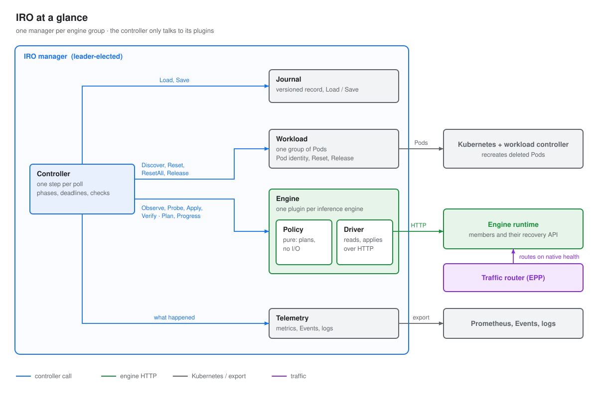

# Architecture

IRO keeps a multi-node inference engine serving through faults. It watches one engine group, the Pods that
run the engine's members (for vLLM, its DP ranks). When a member fails, IRO removes it in place so the rest keep
serving, then brings the group back to full capacity by resetting the failed Pod. Only when that cannot work
does it restart the whole group.

The controller knows no engine and no workload type. It talks to them through two plugins: the
[workload](workloads/index.md) (LeaderWorkerSet today) and the [engine](engines/index.md)
(vLLM today). Its state lives in a versioned [journal](components/journal.md), so a new leader picks up a
recovery where the old one stopped.

## A fault, end to end

[example member-dies]: scenarios/member-dies.json

Every failure IRO handles, step by step with every call it makes, is in [Failures](failures/index.md).

The controller is always in one of three phases. A fault moves it from `serving` to `recovering`; a reconfig that
removes the dead member brings it back. A `ResetAll` is the only way back to `starting`.

## Components

| Component | What it does | Read |
|---|---|---|
| Controller | phases, deadlines, checks on every plan, resets, restoring capacity | [controller.md](components/controller.md) |
| Workload | reports the group's Pods, resets or releases them | [workload.md](workloads/index.md), [LWS](workloads/lws.md) |
| Engine | reports members and their state, plans and sends reconfigs | [engine.md](engines/index.md), [vLLM](engines/vllm.md) |
| Journal | durable controller state, one writer at a time | [journal.md](components/journal.md) |
| Telemetry | logs, metrics, Events, incident records | [telemetry.md](components/telemetry.md) |

The boundaries between them, and why they are drawn there, are in [Components and contracts](components/index.md).
