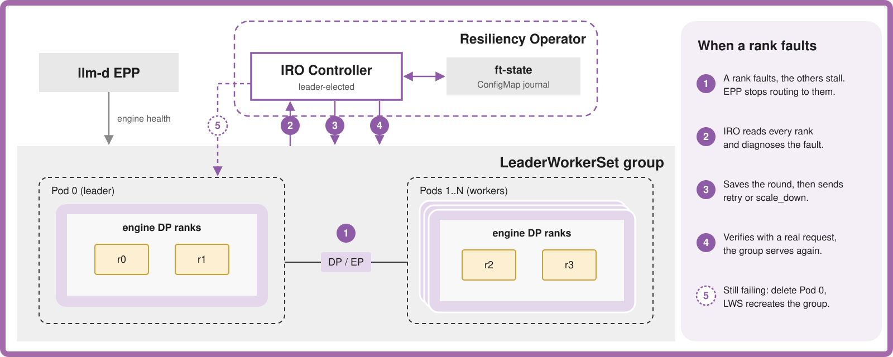
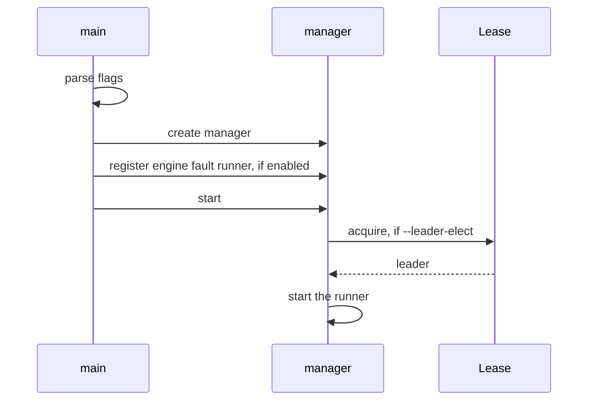

# Architecture

IRO (inference resiliency operator) is one controller-runtime binary. Engine
fault recovery runs inside it, on the elected replica.

| Part | Job | Doc |
| --- | --- | --- |
| Recovery controller | The state machine, one tick per second | [State machine](design/engine-fault-state-machine.md) |
| Engine adapter | Talks to the engine ranks, picked with `--engine` | [Adapters](design/adapters.md) |
| Workload adapter | Finds the group, recreates it, keeps the journal | [Adapters](design/adapters.md), [LWS](workloads/lws.md) |
| Journal | Saved state for restarts | [Journal and failover](design/journal-and-failover.md) |
| Router (EPP) | Routes traffic on each rank's own health | |

---

## Startup

The runner only runs on the leader, and engine fault recovery won't start
without leader election. `--engine` picks the engine adapter by name from the
registry in `cmd/main.go`. One IRO instance handles one engine group today.

---

## Code Layout

| Package | Role |
| --- | --- |
| `cmd` | entry point, flags, manager |
| `internal/controller/enginefault` | recovery controller, decisions, runner, setup |
| `internal/engine` | engine contract and shared types |
| `internal/workload/lws` | LWS adapter |
