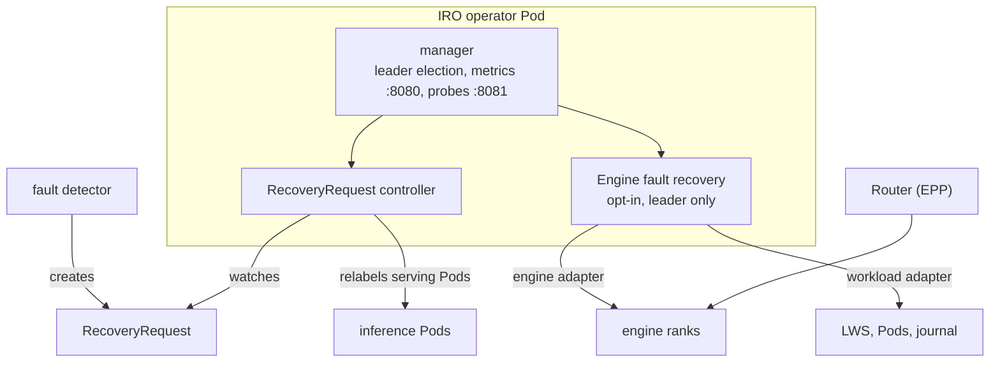
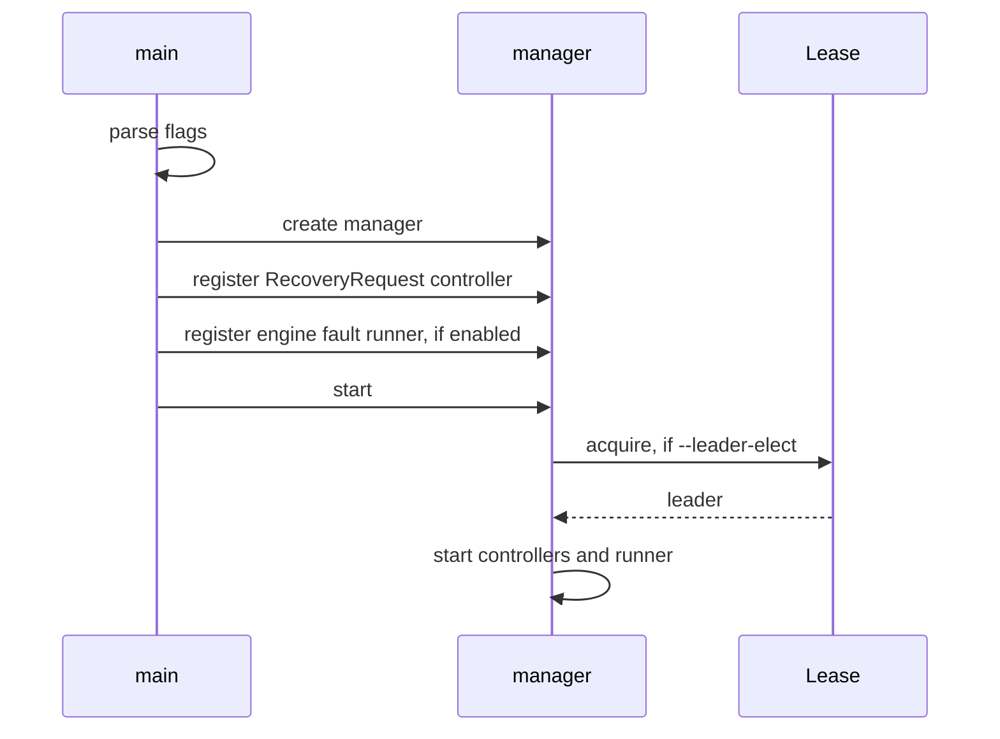

# Architecture

IRO (inference resiliency operator) is one controller-runtime binary with two
recovery paths.

| Path | Trigger | Scope | IRO acts on | State kept in | Docs |
| --- | --- | --- | --- | --- | --- |
| RecoveryRequest | a request from a fault detector | node or device | Pod serving labels | the request's status | [CRDs](crds.md) |
| Engine fault recovery | ranks report faults | one engine group | the engine's FT API, the group's leader Pod | journal ConfigMap | [design](design/engine-fault-recovery.md) |

---

## Startup

With leader election on, both paths run only on the leader. Engine fault
recovery won't start without it.

---

## Code Layout

| Package | Role |
| --- | --- |
| `cmd` | entry point, flags, manager |
| `apis/inference/v1alpha1` | RecoveryRequest types |
| `internal/controller/recoveryrequest` | RecoveryRequest controller |
| `internal/controller/enginefault` | recovery controller, decisions, runner, setup |
| `internal/engine` | engine contract and shared types |
| `internal/engine/vllm` | vLLM adapter |
| `internal/workload/lws` | LWS adapter |
| `runtime/vllm` | Pod-side bridge for vLLM |
| `deploy/kubernetes`, `deploy/vllm-ft` | base manifests and the engine fault overlay |

---

## Deployment

- One Deployment with its ServiceAccount and a ClusterRole for RecoveryRequest
  and nodes ([deploy/kubernetes](../deploy/kubernetes)).
- The engine fault overlay ([deploy/vllm-ft](../deploy/vllm-ft/README.md)) adds
  a namespaced Role for one LWS and the flags to turn it on.
- One IRO instance handles one engine group today.
