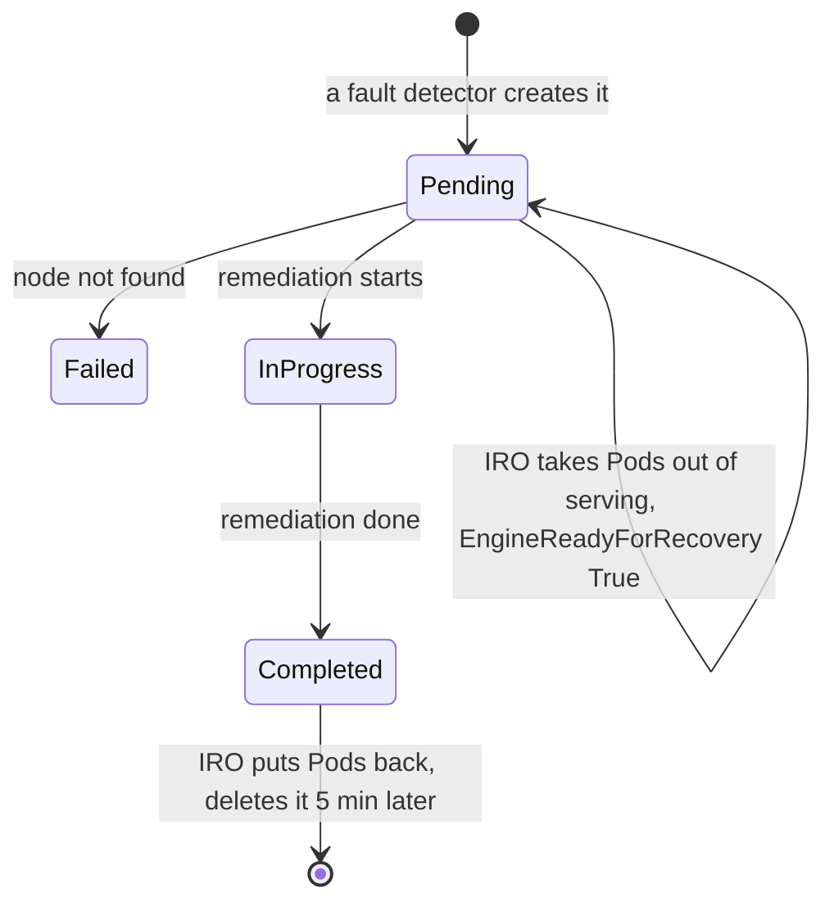

# CRDs

IRO defines one CRD, `RecoveryRequest`, for node and device recovery. Engine
fault recovery has no CRD. Its state lives in a ConfigMap
([journal](design/journal-and-failover.md)).

## RecoveryRequest

- **API**: `inference.llm-d.io/v1alpha1`
- **Scope**: namespaced, short name `rr`, with a status subresource
- **Manifest**: [deploy/kubernetes/crd.yaml](../deploy/kubernetes/crd.yaml)

### Spec

| Field | Required | Values |
| --- | --- | --- |
| `nodeName` | yes | Node to recover |
| `deviceID` | no | Device on that node, for example a GPU index |
| `errorCode` | no | Error reported by the detector |
| `requestedAction` | yes | `RESET_DEVICE`, `REBOOT_NODE` or `REPLACE_NODE` |

### Status

| Field | Values |
| --- | --- |
| `phase` | `Pending`, `InProgress`, `Completed`, `Failed` |
| `conditions` | `EngineReadyForRecovery`, `NodePresent` |

### Lifecycle



IRO only moves a request to `Failed`. Another component sets `InProgress` and
`Completed`.

| Phase | What IRO does |
| --- | --- |
| unset or `Pending` | Checks the node exists; if not, `Failed` with `NodePresent` False. Sets `llm-d.ai/inference-serving=false` on the selected Pods, then `EngineReadyForRecovery` True. |
| `InProgress`, `Failed` | Nothing. |
| `Completed` | Sets the label back to `true`, writes the annotation `inference-resilience-operator.llm-d.io/completion-time`, and deletes the request 5 minutes later. |

### Example

```yaml
apiVersion: inference.llm-d.io/v1alpha1
kind: RecoveryRequest
metadata:
  name: rr-gpu-node-1
  namespace: default
spec:
  nodeName: gpu-node-1
  deviceID: "3"
  requestedAction: RESET_DEVICE
```

### Known Gaps

- Pods are selected by `--pod-namespace` and `--pod-label-key` only, not by
  node, so every matching Pod in the namespace is relabeled.
- The selector uses `--pod-label-key`, but the label written is always
  `llm-d.ai/inference-serving`.
- The shipped RBAC doesn't give this controller the Pod access it needs
  (cluster-wide list and watch, and update).
- While `Pending`, every reconcile rewrites the condition's timestamp.
