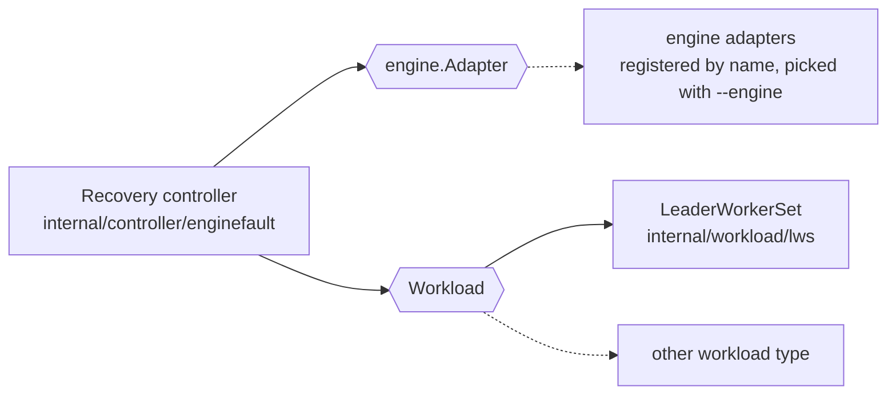
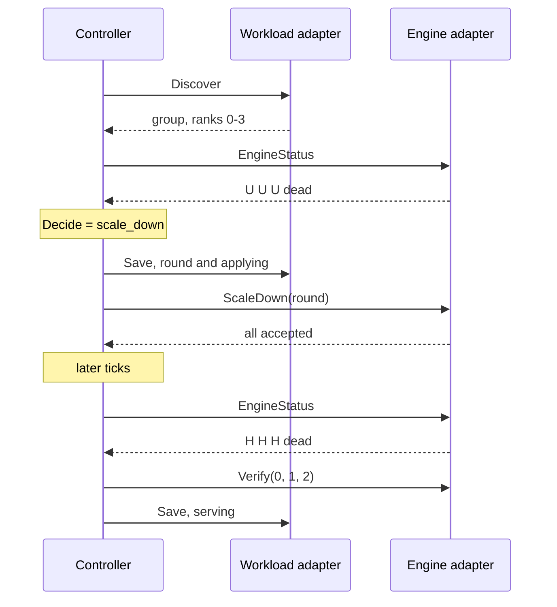

# Engine and Workload Adapters

- **Revision**: 1
- **Last Updated**: 2026-10-11

---

## Problem

The recovery controller has to work with more than one inference engine, and
possibly more than one way of running a group. It shouldn't know HTTP paths,
Pod names or engine flags.

---

## Design Overview

The controller only calls these two interfaces. `setup.go` picks the engine
adapter named by `--engine` from the registry in `cmd/main.go` and builds the
LWS client. The controller tests replace both with fakes.

---

## Engine Contract

`engine.Adapter` in `internal/engine/adapter.go`.

| Call | Takes | Returns | Must |
| --- | --- | --- | --- |
| `EngineStatus` | group | one `RankStatus` per rank | Never fail as a whole. A rank it can't read is `unknown`. |
| `ResumeEngine` | group, round | acceptances | Send `retry` to every participant at once. Error unless all accept. |
| `ScaleDown` | group, round | acceptances | Same, with `scale_down` and the removed ranks. |
| `Verify` | group, ranks | error | Get a real completion from every listed rank. |

### What the engine has to guarantee

- One native state per rank: `healthy`, `unhealthy`, `diagnosing` or `dead`.
- `dead` is final for that process. A dead rank never serves again in the same
  group.
- Ranks keep their original numbers after others are removed.
- Each rank reports the ID of the last FT round it ran.
- Accepting a round only means it started. Completion shows in the rank states.
- Survivors keep running while a fault is diagnosed and recovered.
- A rank that isn't healthy rejects requests, so the router can trust native
  health.
- When applying `scale_down`, the engine checks it can still run the model and
  rejects the round if not.

### Types

| Type | Key fields |
| --- | --- |
| `Group` | `id`, `endpoints` |
| `Endpoint` | `rank`, `url`, `pod`, `pod_uid`, `diagnostics_url` |
| `RankStatus` | `rank`, `status`, `process_exit_confirmed`, `ft_state`, `ft_error`, `request_id` |
| `Round` | `id`, `group_id`, `participants`, `removed`, `master_ip`, `store_port` |
| `Acceptance` | `rank`, `accepted`, `error` |

Rounds always name original ranks. `master_ip` and `store_port` are only set
when the round has to move the engine's coordination store.

---

## Workload Contract

`Workload` in `internal/controller/enginefault/controller.go`.

| Call | Returns | Must |
| --- | --- | --- |
| `Discover` | group ID and one endpoint per rank | Fail rather than return a partial group. Change the ID when any Pod or container is replaced. |
| `Reset` | error | Recreate the whole group, touching only the recorded incarnation. Safe to repeat. |
| `Load` | journal bytes | Empty on first run. |
| `Save` | error | Never overwrite a newer write. |

---

## One Tick Through the Adapters

---

## Adding an Engine

1. Implement `engine.Adapter` in `internal/engine/<engine>/`.
2. Map the engine's states to the four native states. Anything unreadable is
   `unknown`.
3. Register it under a name in the `adapters` map in `cmd/main.go`, and select
   it with `--engine=<name>`.
4. Add any Pod-side pieces the engine needs, such as a process observer for
   exit evidence.
5. Test with the controller fakes, and add a page under `docs/engines/`.

## Adding a Workload Type

1. Implement `Workload`.
2. Make the group ID change on any Pod or container replacement, and make
   `Reset` safe to repeat.
3. Wire it in `setup.go`, and add a page under `docs/workloads/`.

---

## Today

| Contract | Implementation | Doc |
| --- | --- | --- |
| `engine.Adapter` | none registered yet | |
| `Workload` | `internal/workload/lws` | [LeaderWorkerSet workload](../workloads/lws.md) |
