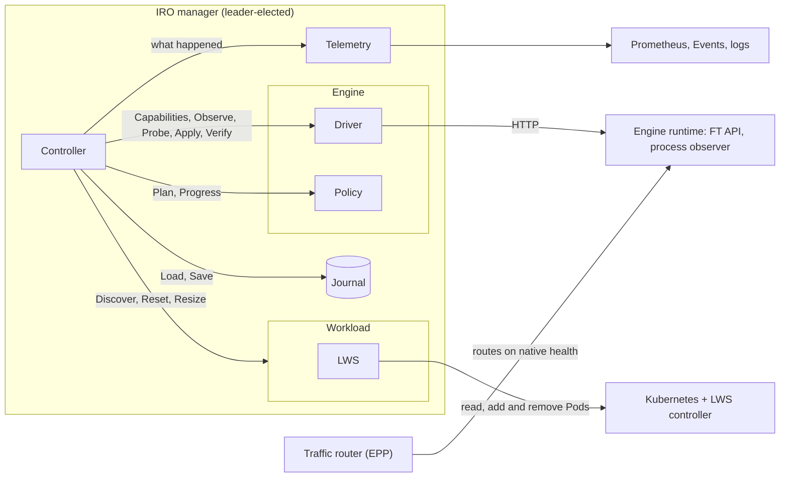
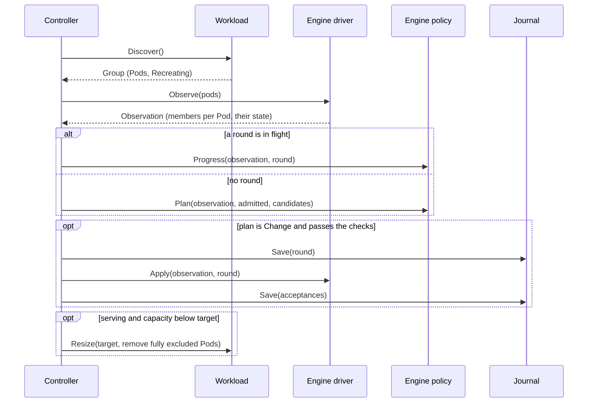
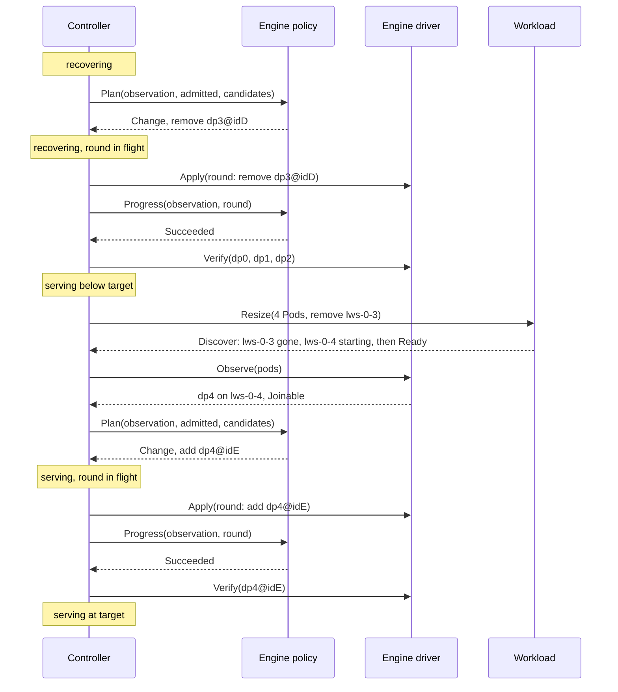

# IRO components and contracts

- **Status:** draft for discussion
- **Author:** Itay Etelis
- **Date:** 2026-10-12
- **Based on:** PR #11 at `9a3a10c` (controller, LWS), PR #19 at `5a03f3e` (vLLM). "Today" in these docs means that code.
- **Code:** the interfaces and types are in [`internal/workload`](../../../internal/workload), [`internal/engine`](../../../internal/engine),
  [`internal/journal`](../../../internal/journal) and [`internal/controller/enginefault`](../../../internal/controller/enginefault). No implementation yet.
- **Scope:** recovery of one engine group, including getting back to full capacity after a shrink.
  Resizing is part of the contract now. LWS and vLLM implement it later; until then the calls answer
  `ErrUnsupported` and IRO keeps today's behavior.

## Problem

The controller, the workload and the engine adapter share types that describe vLLM and LWS:
DP ranks, a TCPStore address, vLLM status strings, a per-rank API port, a process observer.
A second engine, a second workload type, or scaling up after a scale-down would each
need changes in all three. This doc fixes the boundaries before more is built on them.

## Components

| Component | Owns | Must not know | Doc |
|---|---|---|---|
| Controller | phases, deadlines, durability, whether it is still the same group, connecting Pods to members, resets, the capacity target, checks on every plan | engine states, ranks, Pod layout | [controller.md](controller.md) |
| Journal | durable controller state, one writer at a time | what the bytes mean | [journal.md](journal.md) |
| Telemetry | logs, metrics, Events, incident records, readiness. Best-effort, never read back. | how recovery decides anything | [telemetry.md](telemetry.md) |
| Workload | reporting the group's Pods as they are now, resetting it, resizing it | ranks, ports, engine processes, anything from before | [workload.md](workload.md) |
| Engine driver | reporting which members run on each Pod and their state, sending rounds, inference probes | phases, deadlines, Kubernetes, anything from before | [engine.md](engine.md#interface) |
| Engine policy | which members to remove or admit and when, how a round is going | I/O, time, Kubernetes | [engine.md](engine.md#interface) |

Outside IRO, but the contracts depend on them:

| External | What IRO relies on |
|---|---|
| Kubernetes + LWS controller | recreates the group after a reset, and decides how often and whether to keep doing so (`restartBackoff`, `maxGroupRestarts`). Later: removes and adds Pods without recreating it. |
| Engine runtime | exposes engine state and accepts recovery rounds |
| Traffic router (EPP) | routes on the engine's native health. IRO never steers traffic. |
| Leader election | one controller acts on a group at a time |

## How the component docs are laid out

Every component doc has the same parts, in this order:

1. **What it is** and what it does not do.
2. **Interface**: the Go interface.
3. **Objects**: every type the component owns.
4. **Functions**: one section per function, with its input, output and an example.
5. **Behavior**, **Rules** and **Considerations**.
6. **Implementations**: LWS or vLLM today, and what has to change.

## Running example

All examples use the same group. Four Pods, one engine member each (member names come from the engine; here, vLLM's `dp<rank>`):

| Pod | UID | Identity | Member | MemberID |
|---|---|---|---|---|
| `lws-0` (leader) | `a1` | `idA` | `dp0` | `dp0@idA` |
| `lws-0-1` | `b1` | `idB` | `dp1` | `dp1@idB` |
| `lws-0-2` | `c1` | `idC` | `dp2` | `dp2@idC` |
| `lws-0-3` | `d1` | `idD` | `dp3` | `dp3@idD` |

The story: the group serves. `dp3` dies. The engine shrinks to `dp0`-`dp2`. IRO asks the workload to
remove `lws-0-3` and keep 4 Pods. A new Pod `lws-0-4` (UID `e1`, identity `idE`) starts and runs `dp4`.
The engine admits `dp4@idE`. The group is back to 4 members.

## One reconciliation step

Two kinds of action, with opposite delivery rules:

| Action | Delivery | Why |
|---|---|---|
| Engine round (`Apply`) | at most once. Saved first, never sent again. | a round is not idempotent. Sending it twice can break the group. |
| Workload call (`Reset`, `Resize`) | repeated every poll until `Discover` shows the result | each call states an end state, so repeating it is harmless |

## From a fault back to full capacity

1. **The engine decides who leaves.** The policy proposes `Remove`. `Progress` reports `Succeeded` once those members are out, and only then does the controller record them as excluded.
2. **The controller asks the workload for the new shape, in one call.** Each member names its Pod, so the
   controller knows `lws-0-3` now holds only excluded members. It calls `Resize` with that Pod in `Remove`
   and the target in `Pods`: the Pod count the group had when it first served. The workload decides how to
   get there. There is no deadline; scheduling and model loading take as long as they take.
3. **The engine decides who joins.** New Pods show up as candidates. The policy plans `Add` when the engine can admit them, and the round runs like any other.
4. **Faults come first.** A fault at any point moves the group to `recovering`. The capacity work pauses and continues from the same step once the group serves again.

A workload that cannot resize answers `ErrUnsupported`, and an engine that cannot admit members says so
in its capabilities. Then, by default, IRO resets the group after `--ft-capacity-reset-delay` to come back
at full size. With `--ft-capacity-restore=in-place` it keeps serving below target instead.

## Where each object lives

| Object | Defined in | Made by | Read by |
|---|---|---|---|
| `Group`, `Pod`, `PodState`, `PodRef` | [workload.md](workload.md#objects) | workload | controller, engine driver |
| `ResizeRequest` | [workload.md](workload.md#objects) | controller | workload |
| `ErrUnsupported` | [workload.md](workload.md#objects) | workload | controller |
| `Capabilities`, `Member`, `MemberID`, `Observation` | [engine.md](engine.md#objects) | engine driver | controller, engine policy |
| `Round` | [engine.md](engine.md#objects) | controller | engine driver, engine policy |
| `Acceptance` | [engine.md](engine.md#objects) | engine driver | controller |
| `Plan`, `Progress` | [engine.md](engine.md#objects) | engine policy | controller |
| `Config`, `Record`, `Phase`, `MemberState`, `Capacity` | [controller.md](controller.md#objects) | controller | journal (as bytes), telemetry |
| `Recorder`, `Incident`, `Outcome`, `Durations`, `ResetReason` | [telemetry.md](telemetry.md#objects), code in `internal/controller/enginefault` | controller | telemetry |

## Today vs target

| Where | Today | Target |
|---|---|---|
| `engine.Round` | `MasterIP`, `StorePort` | removed. The vLLM driver picks the store master in `Apply`. |
| `engine.RankStatus` | copy of the vLLM status payload (status strings, `FTState`, `RequestID`, `Mask`) | `Member` plus driver-private `Observation.Engine` |
| `Decide`, `finishRound` | controller, vLLM rules | vLLM `Policy.Plan`, `Policy.Progress` |
| `probeDiagnosis` | controller sends a completion | `Driver.Probe` |
| Pod-to-rank mapping | `lws.Discover` builds it and checks `rank == worker * ranksPerPod + local` | the vLLM driver reports ranks per Pod. The controller connects them. |
| `--ft-store-port` | controller flag | vLLM driver flag |
| `lws.Discover` | calls the rank observer, knows the API port and rank layout | returns Pods. The vLLM driver's `Observe` reports which ranks run on each. |
| `lws.Discover` while Pods start | error, so the controller waits blind | Pods come back with their state: `Starting`, `Ready`, `Terminating` |
| `lws.Reset` | finds the leader through rank 0 | Pod index 0 |
| `Group.ID` | hash of every Pod and container identity, made by the workload | no group ID. The controller compares the reported Pods with its journal. |
| `State.Excluded` | `[]int` ranks | members by `MemberID`: candidate, admitted, excluded, rejected |
| Excluded Pods | stay until the next reset | removed through `Workload.Resize` |
| Lost capacity | comes back only with a reset | in place (`Workload.Resize` + engine admits) when supported, otherwise a capacity reset after a delay (`--ft-capacity-restore`) |
| Phases `diagnosing`, `applying` | two phases that differ only by whether a round is in flight | one `recovering` phase. The round in flight is a field, so a growth round can run while `serving`. |
| Reset budget, `intervention_required` | after 3 resets in 30 min IRO stops and waits for a human | removed. LWS `restartBackoff` and `maxGroupRestarts` pace resets and decide when to stop. |
| `Workload.Load/Save` | part of `Workload` | `Journal` |
| Logs, metrics, Events | error logs only, no IRO metrics, no Events, readiness is a ping | `Recorder`: `llm_d_iro_*` metrics, Events per incident, incident history, a readiness check on loop progress (#25, #30) |
| `Instruction` in the journal | `retry` / `scale_down` | plan kind and round diff |
| retry flap window | keyed on `retry` | keyed on "no membership change" (C6) |

## Open decisions

1. **Disaggregated sets.** A prefill/decode set has several engine groups with different roles.
   Proposal: one recovery unit per engine group, each with its own Group, journal and controller loop.
2. **Restart policy.** With per-Pod comparison, a restarted Pod's old members are lost and its new ones
   become candidates. That only happens if LWS stops recreating the whole group on a restart
   (`restartPolicy: None`). Today IRO requires `RecreateGroupOnPodRestart`. Which should it require?
3. **Standby engines and C5.** Does a vLLM engine waiting to join report healthy to the router?
4. **Where the target comes from.** Proposal: the Pod count when the group first served.
   If an autoscaler also changes the size later, whose target wins?
5. **vLLM rank numbering.** The FT path keeps frozen original ranks; elastic EP renumbers densely.
   The vLLM driver bridges them, and opaque member names keep this out of the contract.
6. **Pods with some members excluded.** With several ranks per Pod, losing one rank does not free the
   Pod (C8), so that capacity stays lost until a reset. Should the policy be allowed to remove the
   healthy rest of the Pod so it can be replaced?
7. **Remove first, or add first?** The workload decides, since `Resize` carries both in one call.
   Proposal for LWS: remove first. It frees the GPUs and the slot, and it works on a full cluster.
8. **LWS restart limits for IRO resets.** `restartBackoff` and `maxGroupRestarts` are on LWS `main`, not in
   v0.11.1. Check that a recreation IRO causes, by deleting the leader, is paced and counted like any other.
   Until they ship, IRO resets are not paced at all.
