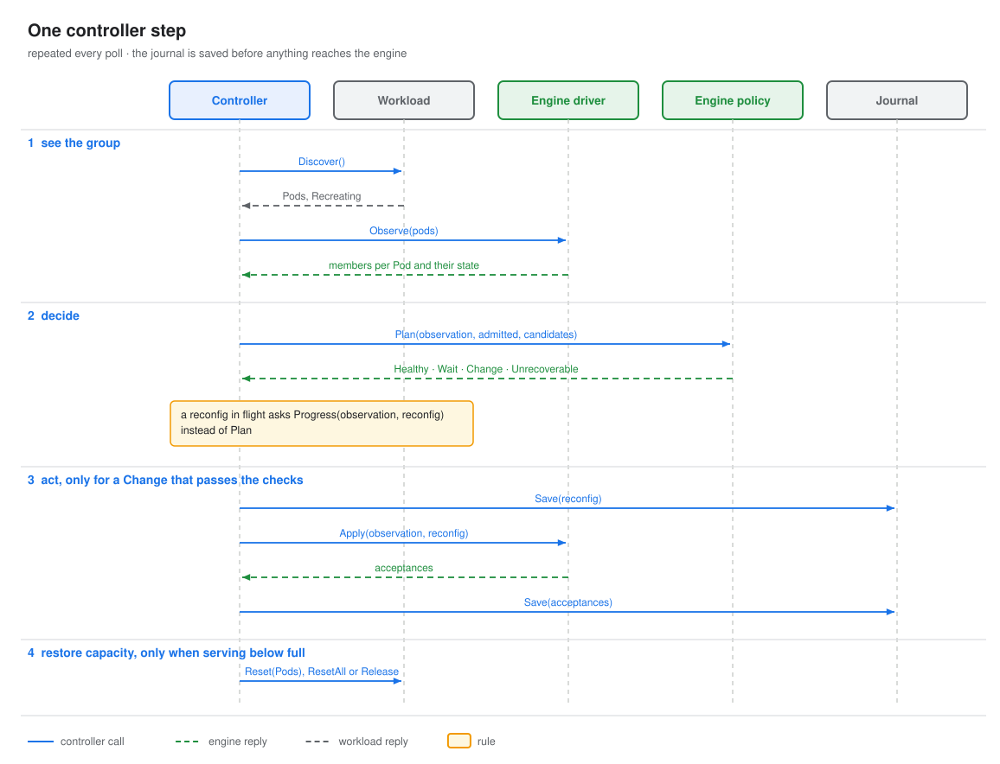
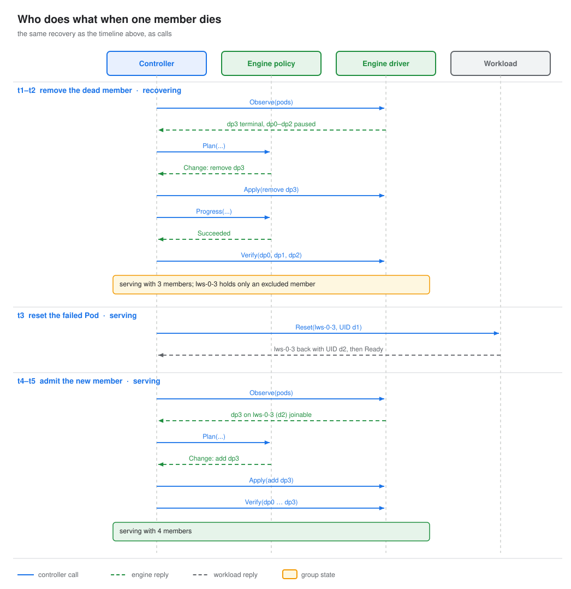

# IRO components and contracts

- **Author:** Itay Etelis
- **Date:** 2026-10-12

## Problem

Recovery involves three parties: the controller, the workload that runs the Pods, and the inference engine.
If they share the details of one engine or one workload type, such as rank numbers, store addresses, status
strings or ports, then every new engine, every new workload type, and scaling back up after a shrink means
changing all three. This doc fixes the boundaries: the controller sees only Pods and members, and everything
specific to an engine or a workload stays behind its plugin.

## Components

| Component | Owns | Must not know | Doc |
|---|---|---|---|
| Controller | phases, deadlines, durability, whether it is still the same group, connecting Pods to members, resets, bringing capacity back, checks on every plan | engine states, what a member is inside the engine, Pod layout | [controller.md](controller.md) |
| Journal | durable controller state, one writer at a time | what the bytes mean | [journal.md](journal.md) |
| Telemetry | logs, metrics, Events, incident records, readiness. Best-effort, never read back. | how recovery decides anything | [telemetry.md](telemetry.md) |
| Workload | reporting the group's Pods as they are now, resetting some Pods or all of them, releasing Pods | engine members, ports, engine processes, anything from before | [workload.md](workload.md) |
| Engine driver | reporting which members run on each Pod and their state, sending reconfigs, inference probes | phases, deadlines, Kubernetes, anything from before | [engine.md](engine.md#interface) |
| Engine policy | which members to remove or admit and when, how a reconfig is going | I/O, time, Kubernetes | [engine.md](engine.md#interface) |

Outside IRO, but the contracts depend on them:

| External | What IRO relies on |
|---|---|
| Kubernetes + the workload's controller | recreates the group after a reset, and decides how often and whether to keep doing so (for LWS, `restartBackoff` and `maxGroupRestarts`). Later: removes and adds Pods without recreating it. |
| Engine runtime | exposes engine state and accepts recovery reconfigs |
| Traffic router (EPP) | routes on the engine's native health. IRO never steers traffic. |
| Leader election | one controller acts on a group at a time |

## Examples

The examples in these docs use one group: four Pods, `pod-0` to `pod-3` (UIDs `a1` to `d1`, identities `idA` to
`idD`), with one member each, `m0` to `m3`. Step through it, fault by fault, in [Examples](../../examples/index.md).

## One reconciliation step

Two kinds of action, with opposite delivery rules:

| Action | Delivery | Why |
|---|---|---|
| Engine reconfig (`Apply`) | at most one run. Saved first. Sent again, same ID, only when the send was never confirmed and `Progress` proves no member got it. | running a reconfig twice can break the group, so a resend needs proof, and a member that already got it ignores it |
| Workload call (`Reset`, `ResetAll`, `Release`) | saved first, repeated every poll until `Discover` shows the result | each call names Pods by UID and does nothing once they are gone, so repeating it is harmless |

## From a fault back to full capacity

1. **Remove the dead member.** The driver reports `m3` Terminal. The policy proposes `Remove`, the reconfig
   runs, and `Progress` reports `Succeeded`. Only then does the controller record `m3@idD` as excluded and
   verify the survivors.
2. **Reset the failed Pod.** Each member names its Pod, so the controller knows `pod-3` now holds only
   excluded members. It calls `Reset` on it. The rest of the group keeps serving. There is no deadline;
   scheduling and model loading take as long as they take.
3. **Admit the new member.** The new Pod's members show up as candidates. The policy plans `Add` when the
   engine can admit them, the reconfig runs like any other, and the reconfig's members are verified.

A fault at any point comes first: the group goes to `recovering`, and the capacity work continues once the
group serves again.

Capacity never comes from new Pods elsewhere: it comes back by resetting, with one try. If resetting the
Pod fails in any way (the workload answers `ErrUnsupported`, the engine cannot admit members, or the new Pod
fails to join), the group keeps serving with fewer members until the next group. With
`--ft-capacity-restore=reset-all`, IRO resets the whole group instead and never stays below full. With
`release`, it frees the failed Pod's GPUs and serves below full.

## Where each object lives

| Object | Defined in | Made by | Read by |
|---|---|---|---|
| `Group`, `Pod`, `PodState`, `PodRef` | [workload.md](workload.md#objects) | workload | controller, engine driver |
| `ErrUnsupported` | [workload.md](workload.md#objects) | workload | controller |
| `Capabilities`, `Member`, `MemberID`, `Observation` | [engine.md](engine.md#objects) | engine driver | controller, engine policy |
| `Reconfig` | [engine.md](engine.md#objects) | controller | engine driver, engine policy |
| `Acceptance` | [engine.md](engine.md#objects) | engine driver | controller |
| `Plan`, `Progress` | [engine.md](engine.md#objects) | engine policy | controller |
| `Config`, `Record`, `Phase`, `MemberState`, `PodRecord` | [controller.md](controller.md#objects) | controller | journal (as bytes), telemetry |
| `Recorder`, `Incident`, `Outcome`, `Durations`, `ResetReason` | [telemetry.md](telemetry.md#objects), code in `internal/controller/enginefault` | controller | telemetry |

## Code layout

Every file the design needs, and the PR that brings it.

| File | Holds | Comes with |
|---|---|---|
| `internal/workload/workload.go` | `Workload` and its objects | contracts (#32) |
| `internal/engine/engine.go` | `Engine`, `Driver`, `Policy` and their objects | contracts (#32) |
| `internal/journal/journal.go` | `Journal` | contracts (#32) |
| `internal/controller/enginefault/controller.go` | `Controller`, `Config`, `Record` | contracts (#32) |
| `internal/controller/enginefault/recorder.go` | `Recorder`, `Incident` | contracts (#32) |
| `internal/controller/enginefault/step.go` | `New` and `Step`: phases, reading Discover, connecting members, checks | controller (#11) |
| `internal/controller/enginefault/reconfig.go` | sending and watching reconfigs, plan checks, `Verify`, `ResetAll` | controller (#11) |
| `internal/controller/enginefault/capacity.go` | restoring capacity | controller (#11) |
| `internal/controller/enginefault/incident.go` | incident records | controller (#11) |
| `internal/controller/enginefault/runner.go` | the leader-elected loop that calls `Step` | controller (#11) |
| `internal/controller/enginefault/setup.go` | flags; picks the engine and workload | controller (#11) |
| `cmd/main.go` | registers engines and workloads, starts the manager | controller (#11) |
| `internal/workload/lws/workload.go` | LWS `Workload` | controller (#11), see [lws.md](../lws.md) |
| `internal/journal/configmap/journal.go` | ConfigMap `Journal`, owned by the workload object | controller (#11) |
| `internal/telemetry/recorder.go` | `Recorder`: log lines (#11); metrics, Events, incident history later | controller (#11), telemetry |
| `internal/engine/vllm/driver.go` | vLLM `Driver` | vLLM (#19) |
| `internal/engine/vllm/policy.go` | vLLM `Policy` | vLLM (#19) |

## Open decisions

1. **Disaggregated sets.** A prefill/decode set has several engine groups with different roles.
   Proposal: one recovery unit per engine group, each with its own Group, journal and controller loop.
2. **Pods with some members excluded.** With several members per Pod, losing one member does not let IRO
   reset the Pod (C8), so that capacity stays lost until `ResetAll`. Should the policy be allowed to remove
   the healthy rest of the Pod so the Pod can be reset?
