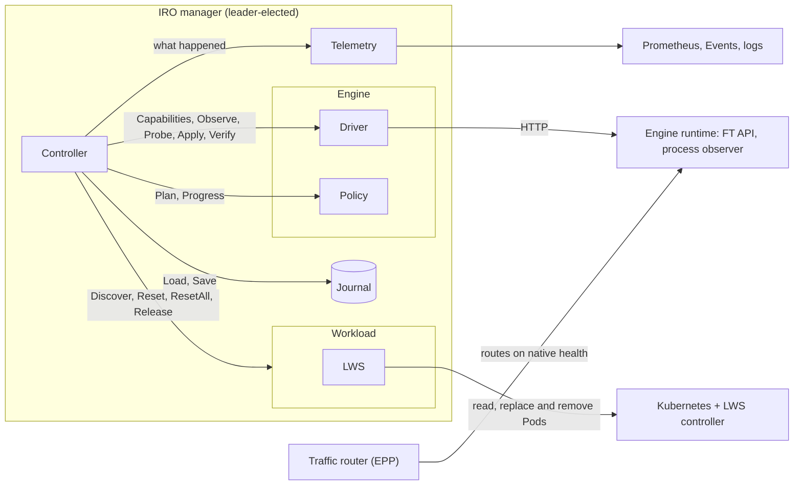
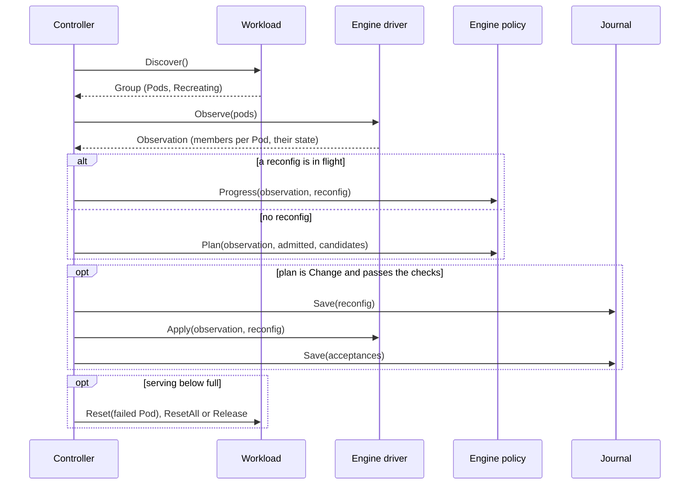
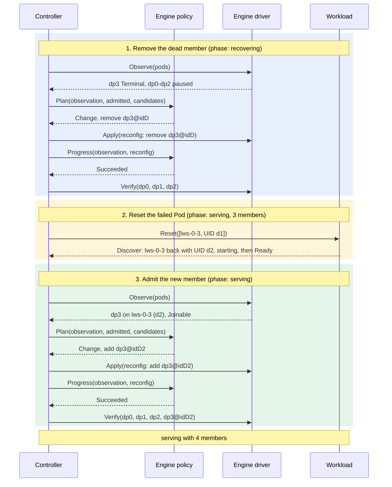

# IRO components and contracts

- **Status:** draft for discussion
- **Author:** Itay Etelis
- **Date:** 2026-10-12
- **Based on:** PR #11 at `9a3a10c` (controller, LWS), PR #19 at `5a03f3e` (vLLM). "Today" in these docs means that code.
- **Code:** the interfaces and types are in [`internal/workload`](../../../internal/workload), [`internal/engine`](../../../internal/engine),
  [`internal/journal`](../../../internal/journal) and [`internal/controller/enginefault`](../../../internal/controller/enginefault). No implementation yet.
- **Scope:** recovery of one engine group, including getting back to full capacity after a shrink by
  resetting the failed Pod or the whole group. Capacity never comes from new Pods elsewhere.

## Problem

The controller, the workload and the engine adapter share types that describe vLLM and LWS:
DP ranks, a TCPStore address, vLLM status strings, a per-rank API port, a process observer.
A second engine, a second workload type, or scaling up after a scale-down would each
need changes in all three. This doc fixes the boundaries before more is built on them.

## Components

| Component | Owns | Must not know | Doc |
|---|---|---|---|
| Controller | phases, deadlines, durability, whether it is still the same group, connecting Pods to members, resets, bringing capacity back, checks on every plan | engine states, ranks, Pod layout | [controller.md](controller.md) |
| Journal | durable controller state, one writer at a time | what the bytes mean | [journal.md](journal.md) |
| Telemetry | logs, metrics, Events, incident records, readiness. Best-effort, never read back. | how recovery decides anything | [telemetry.md](telemetry.md) |
| Workload | reporting the group's Pods as they are now, resetting some Pods or all of them, releasing Pods | ranks, ports, engine processes, anything from before | [workload.md](workload.md) |
| Engine driver | reporting which members run on each Pod and their state, sending reconfigs, inference probes | phases, deadlines, Kubernetes, anything from before | [engine.md](engine.md#interface) |
| Engine policy | which members to remove or admit and when, how a reconfig is going | I/O, time, Kubernetes | [engine.md](engine.md#interface) |

Outside IRO, but the contracts depend on them:

| External | What IRO relies on |
|---|---|
| Kubernetes + LWS controller | recreates the group after a reset, and decides how often and whether to keep doing so (`restartBackoff`, `maxGroupRestarts`). Later: removes and adds Pods without recreating it. |
| Engine runtime | exposes engine state and accepts recovery reconfigs |
| Traffic router (EPP) | routes on the engine's native health. IRO never steers traffic. |
| Leader election | one controller acts on a group at a time |

## How the component docs are laid out

Every component doc has the same parts, in this order:

1. **What it is** and what it does not do.
2. **Interface**: the Go interface.
3. **Objects**: every type the component owns.
4. **Functions**: one section per function, with its input, output and an example.
5. **Behavior**, **Rules** and **Considerations**.

Implementations (LWS, vLLM) are not part of these docs. Each is documented with its own PR.

## Running example

All examples use the same group. Four Pods, one engine member each (member names come from the engine; here, vLLM's `dp<rank>`):

| Pod | UID | Identity | Member | MemberID |
|---|---|---|---|---|
| `lws-0` (leader) | `a1` | `idA` | `dp0` | `dp0@idA` |
| `lws-0-1` | `b1` | `idB` | `dp1` | `dp1@idB` |
| `lws-0-2` | `c1` | `idC` | `dp2` | `dp2@idC` |
| `lws-0-3` | `d1` | `idD` | `dp3` | `dp3@idD` |

The story: the group serves. `dp3` dies. The engine shrinks to `dp0`-`dp2`. IRO asks the workload to
reset `lws-0-3`. It comes back as a new Pod in the same place (UID `d2`, identity `idD2`) and runs `dp3`
again. The engine admits `dp3@idD2`. The group is back to 4 members.

## One reconciliation step

Two kinds of action, with opposite delivery rules:

| Action | Delivery | Why |
|---|---|---|
| Engine reconfig (`Apply`) | at most once. Saved first, never sent again. | a reconfig is not idempotent. Sending it twice can break the group. |
| Workload call (`Reset`, `ResetAll`, `Release`) | saved first, repeated every poll until `Discover` shows the result | each call names Pods by UID and does nothing once they are gone, so repeating it is harmless |

## From a fault back to full capacity

1. **Remove the dead member.** The driver reports `dp3` Terminal. The policy proposes `Remove`, the reconfig
   runs, and `Progress` reports `Succeeded`. Only then does the controller record `dp3@idD` as excluded and
   verify the survivors.
2. **Reset the failed Pod.** Each member names its Pod, so the controller knows `lws-0-3` now holds only
   excluded members. It calls `Reset` on it. The rest of the group keeps serving. There is no deadline;
   scheduling and model loading take as long as they take.
3. **Admit the new member.** The new Pod's members show up as candidates. The policy plans `Add` when the
   engine can admit them, the reconfig runs like any other, and the reconfig's members are verified.

A fault at any point comes first: the group goes to `recovering`, and the capacity work continues once the
group serves again.

Capacity never comes from new Pods elsewhere: it comes back by resetting, with one try. If resetting the
Pod fails in any way (the workload answers `ErrUnsupported`, the engine cannot admit members, or the new Pod
fails to join), the group keeps serving with fewer members until the next group. With
`--ft-capacity-restore=reset-all`, IRO resets the whole group instead and never stays below full. With
`release`, it frees the failed Pod's GPUs and serves below full.

## Where each object lives

| Object | Defined in | Made by | Read by |
|---|---|---|---|
| `Group`, `Pod`, `PodState`, `PodRef` | [workload.md](workload.md#objects) | workload | controller, engine driver |
| `ErrUnsupported` | [workload.md](workload.md#objects) | workload | controller |
| `Capabilities`, `Member`, `MemberID`, `Observation` | [engine.md](engine.md#objects) | engine driver | controller, engine policy |
| `Reconfig` | [engine.md](engine.md#objects) | controller | engine driver, engine policy |
| `Acceptance` | [engine.md](engine.md#objects) | engine driver | controller |
| `Plan`, `Progress` | [engine.md](engine.md#objects) | engine policy | controller |
| `Config`, `Record`, `Phase`, `MemberState`, `PodRecord` | [controller.md](controller.md#objects) | controller | journal (as bytes), telemetry |
| `Recorder`, `Incident`, `Outcome`, `Durations`, `ResetReason` | [telemetry.md](telemetry.md#objects), code in `internal/controller/enginefault` | controller | telemetry |

## Code layout

Every file the design needs. This PR adds the contracts; each implementation comes with its own PR.

| File | Holds | Comes with |
|---|---|---|
| `internal/workload/workload.go` | `Workload` and its objects | this PR |
| `internal/engine/engine.go` | `Engine`, `Driver`, `Policy` and their objects | this PR |
| `internal/journal/journal.go` | `Journal` | this PR |
| `internal/controller/enginefault/controller.go` | `Controller`, `Config`, `Record` | this PR |
| `internal/controller/enginefault/recorder.go` | `Recorder`, `Incident` | this PR |
| `internal/controller/enginefault/step.go` | `New` and `Step`: phases, reading Discover, checks, restoring capacity | controller PR |
| `internal/controller/enginefault/runner.go` | the leader-elected loop that calls `Step` | controller PR |
| `internal/controller/enginefault/setup.go` | flags; picks the engine and workload | controller PR |
| `cmd/main.go` | registers engines and workloads, starts the manager | controller PR |
| `internal/workload/lws/workload.go` | LWS `Workload` | LWS PR |
| `internal/journal/configmap/journal.go` | ConfigMap `Journal`, owned by the workload object | LWS PR |
| `internal/engine/vllm/driver.go` | vLLM `Driver` | vLLM PR |
| `internal/engine/vllm/policy.go` | vLLM `Policy` | vLLM PR |
| `internal/telemetry/recorder.go` | `Recorder`: logs, metrics, Events, incident history | telemetry PR |

## Open decisions

1. **Disaggregated sets.** A prefill/decode set has several engine groups with different roles.
   Proposal: one recovery unit per engine group, each with its own Group, journal and controller loop.
2. **Pods with some members excluded.** With several ranks per Pod, losing one rank does not let IRO
   reset the Pod (C8), so that capacity stays lost until `ResetAll`. Should the policy be allowed to remove
   the healthy rest of the Pod so the Pod can be reset?
