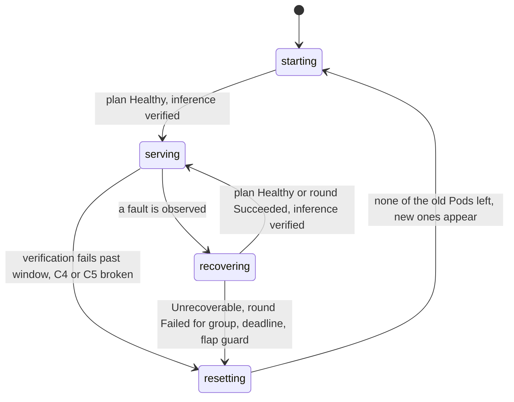
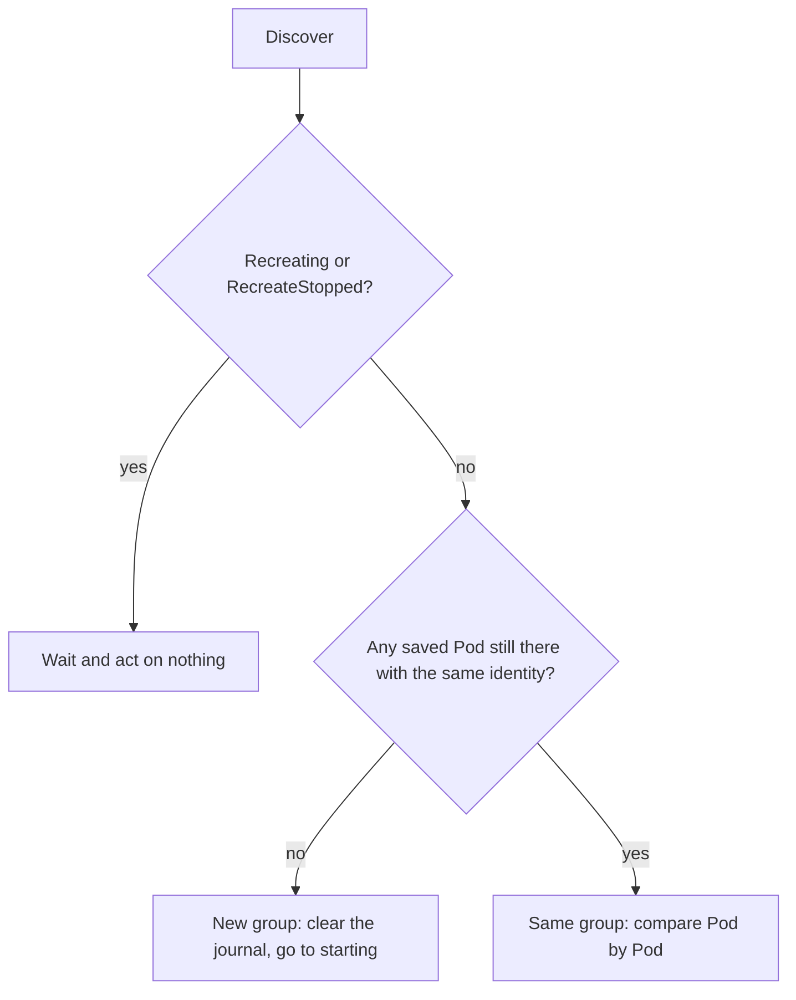
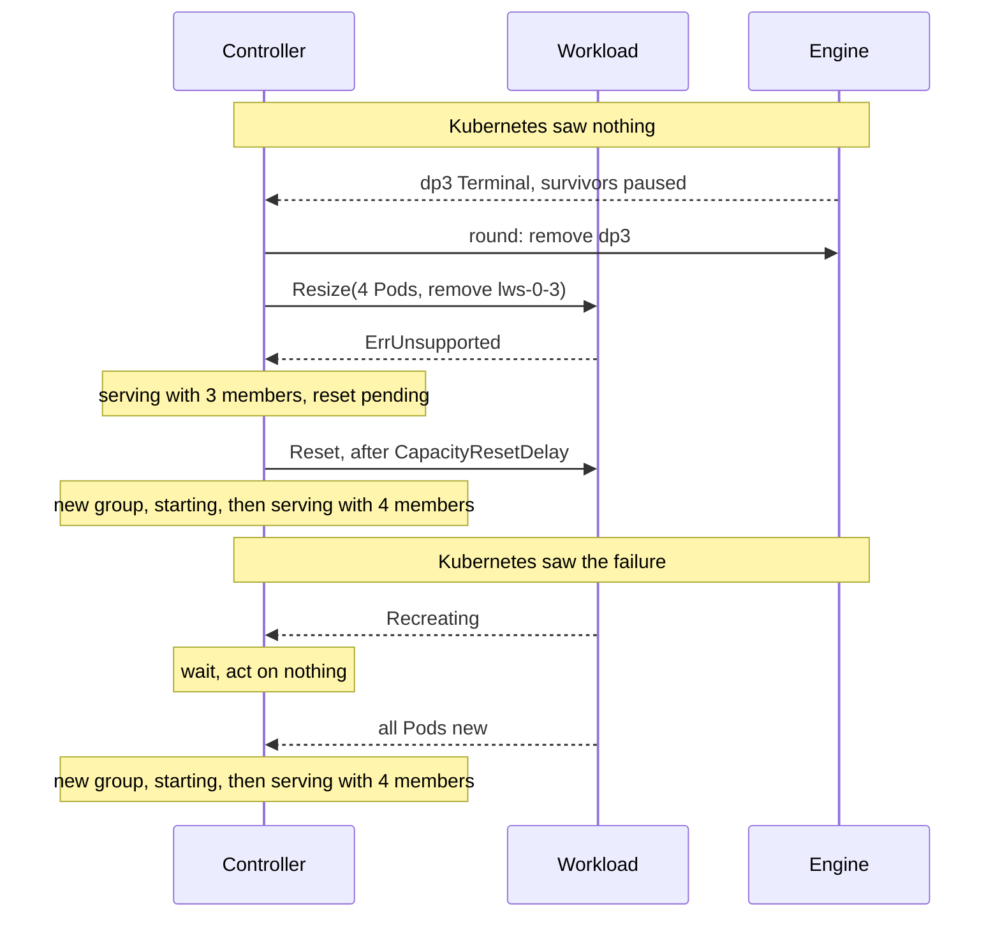
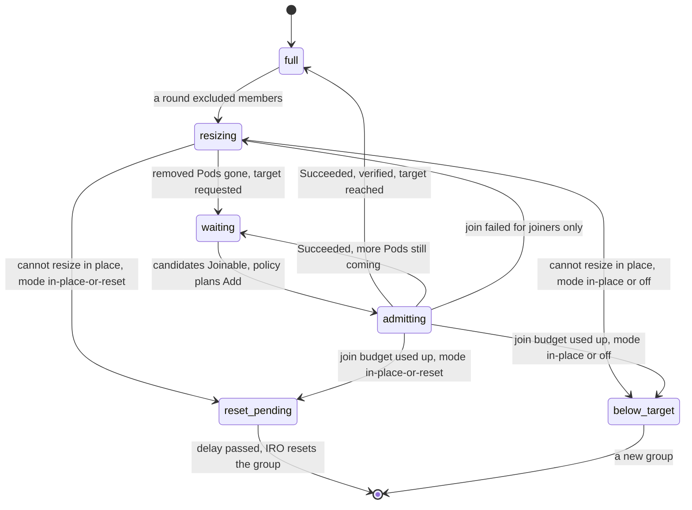

# Controller

The controller runs one loop per engine group, on the elected leader. Every poll it reads the
[workload](workload.md) and the [engine](engine.md), decides what the group needs, and acts.
It owns everything that is not engine- or workload-specific:

- the phases and their deadlines,
- whether it is still the same group,
- connecting Pods to engine members,
- saving state in the [journal](journal.md) before acting,
- resets and the capacity target,
- the checks every engine plan must pass.

It reads only the engine-neutral [`Member`](engine.md#objects) fields and [`Pod`](workload.md#objects)
facts. Everything engine-specific stays in the engine.

## Interface

```go
func New(ctx context.Context, workload Workload, engine Engine, journal Journal, recorder Recorder, config Config) (Controller, error)

type Controller interface {
    Step(ctx context.Context) error
}
```

A runner calls `New` until the journal loads, then `Step` every `PollInterval` while this process leads.
`New` and the defaults below come with the implementation; the code defines `Controller` and its objects.

## Objects

```go
// Config holds the controller's settings. Flags are in Configuration below.
type Config struct {
    PollInterval     time.Duration // 1s
    DiagnosisTimeout time.Duration // 75s: longest time in recovering without a round
    ApplyTimeout     time.Duration // 90s: longest time a round may stay in flight
    VerifyTimeout    time.Duration // 2m: how long a failed inference probe is retried
    FlapWindow       time.Duration // 2m: check C6
    CapacityRestore    CapacityRestore // in-place-or-reset (default) | in-place | off
    CapacityResetDelay time.Duration   // 0: how long to serve below target before resetting to restore it
    JoinBudget       int           // 3 failed joins per group
}

type Phase string // starting | serving | recovering | resetting

// CapacityRestore says how lost capacity comes back.
type CapacityRestore string // in-place-or-reset | in-place | off

type MemberState string // candidate | admitted | excluded | rejected

// PodRecord is what the controller remembers about one Pod.
type PodRecord struct {
    Name     string
    Identity string
    Removing bool // asked to go through Resize
}

// Capacity is the capacity loop's state.
type Capacity struct {
    State        CapacityState // full | resizing | waiting | admitting | reset_pending | below_target
    BelowSince   time.Time     // when the group went below target, for CapacityResetDelay
    Target       int           // Pod count when the group first served
    JoinFailures int
}

type CapacityState string

// Record is the controller's whole state. It is what the journal stores.
type Record struct {
    Phase   Phase
    Since   time.Time // when the phase started. The diagnosis deadline counts from here.
    Reason  string

    Pods    map[string]PodRecord     // by UID. Also what Reset names.
    Members map[MemberID]MemberState

    Round       *Round    // in flight, nil when none
    RoundSince  time.Time // the apply deadline counts from here
    Acceptances []Acceptance
    Verified    []MemberID

    LastNoChangeRound         time.Time // check C6
    VerifyFailedSince         time.Time
    DiscoveryUnavailableSince time.Time
    RecreateStopped           bool // from the last Discover, so people can see the workload gave up

    Incident *Incident // the open incident, nil when none. Closed ones go to telemetry.

    Capacity Capacity
}
```

`Round`, `Acceptance` and `MemberID` come from the [engine](engine.md#objects). `Incident` comes from [telemetry](telemetry.md#objects).

## Functions

### New

Builds the controller and loads its state.

| | |
|---|---|
| **Input** | a [`Workload`](workload.md#interface), an [`Engine`](engine.md#interface), a [`Journal`](journal.md#interface), a [`Recorder`](telemetry.md#interface), a [`Config`](#objects) |
| **Output** | a `Controller`, or an error |
| **Side effects** | `Journal.Load`. Clears `Verified`: a new leader checks inference again before calling the group verified. |

**Examples.**

```go
New(...) // empty journal (first run):       Record{Phase: starting}
New(...) // leader changed during a round:   Record{Phase: recovering, Round: iro-ft-7c1e, ...}. The next Step watches Progress; it never resends.
New(...) // journal unreadable or not valid: error. The runner logs it and calls New again next poll.
```

### Step

Runs one reconciliation: read, decide, act.

| | |
|---|---|
| **Input** | none |
| **Output** | `nil`, or an error that the runner logs. An error never changes the saved phase. |
| **Side effects** | any of `Journal.Save`, `Probe`, `Apply`, `Verify`, `Reset`, `Resize`, and [`Recorder`](telemetry.md#interface) calls for what happened |

In order:

1. **Discover.** If it fails, keep the phase and its deadline clock, note the time, and stop here.
2. **Read Discover** against the journal: same group, new group, or being recreated. See [Reading Discover](#reading-discover).
3. **Observe** the Pods and [connect members to Pods](#connecting-pods-and-members).
4. **Check the observation** (C4, C5). A violation resets the group.
5. **Act by phase.** Ask the policy for a `Plan`, or for `Progress` when a [round](#rounds) is in flight.
   Check and send a new round, verify, or reset. In `resetting`, repeat `Reset` until the old Pods are gone.
6. **Move the [capacity loop](#capacity-loop)** if the group is `serving`.

**Example**, the [running example](README.md#running-example) poll by poll:

| Poll | Discover | Observe | Policy says | Controller does | Phase, round, capacity |
|---|---|---|---|---|---|
| 1 | 4 Pods `Ready` | all `Serving` | `Plan`: Healthy | nothing | serving, full |
| 2 | same | `dp3` Terminal, `dp0`-`dp2` paused | `Plan`: Change, remove `dp3@idD` | enters `recovering`, saves, calls `Probe` once | recovering |
| 3 | same | same | same | waits: under 2 polls in `recovering` | recovering |
| 4 | same | same | same | checks C1-C7, saves round `iro-ft-7c1e`, `Apply`, saves acceptances | recovering, round in flight |
| 5 | same | survivors rebuilding | `Progress`: Running | waits, under the apply deadline | recovering, round in flight |
| 6 | same | `dp0`-`dp2` healthy | `Progress`: Succeeded | marks `dp3@idD` excluded, clears the round, `Verify(dp0, dp1, dp2)` | serving, resizing |
| 7 | same | same | `Plan`: Healthy | `Resize{Pods: 4, Remove: [lws-0-3]}` | serving, resizing |
| 8 | `lws-0-3` Terminating, `lws-0-4` Starting | `dp0`-`dp2` Serving | `Plan`: Healthy | saves `lws-0-4`, waits. No deadline. | serving, waiting |
| ... | `lws-0-4` Ready | `dp4` Joinable | `Plan`: Change, add `dp4@idE` | checks, saves round, `Apply` | serving, admitting |
| ... | same | `dp4` healthy | `Progress`: Succeeded | marks `dp4@idE` admitted, `Verify(dp4@idE)` | serving, full |

The [`Record`](#objects) after poll 5, as the journal stores it and `Recorder.Stepped` receives it:

```yaml
Phase: recovering
Reason: "dp3 is dead; survivors paused"
Round: {ID: iro-ft-7c1e, Participants: [dp0@idA, dp1@idB, dp2@idC], Remove: [dp3@idD]}
Members: {dp0@idA: admitted, dp1@idB: admitted, dp2@idC: admitted, dp3@idD: admitted}
Capacity: {State: full, Target: 4}
RecreateStopped: false
```

## Behavior

### State machine



Four phases, none terminal. Whether a round is in flight is not a phase; it is the `Round` field,
described [below](#rounds). A round can run in `recovering` (fixing a fault) or in `serving` (adding capacity).

| Phase | Meaning | Controller does | Leaves when |
|---|---|---|---|
| `starting` | new group, engine still loading | waits for a `Healthy` plan and ignores any other plan. No deadline: the workload's startup probe owns that, and Kubernetes restarts a failed start as a new group. | plan `Healthy`, then inference verified |
| `serving` | verified and healthy, maybe below the capacity target | plans every poll and moves the [capacity loop](#capacity-loop). A round that admits candidates runs here. | a fault |
| `recovering` | the engine reports a fault | probes once on entry. Without a round: plans every poll and sends a round no sooner than 2 polls in. With a round: checks `Progress` every poll and never sends it again. | `Healthy` plan or round `Succeeded`, then verified. Or reset. |
| `resetting` | workload reset issued | repeats `Reset` with the saved Pods until they are gone. No deadline. The workload decides how fast to recreate the group, and whether to stop. | none of the old Pods are left and new ones appear |

### Reading Discover

The workload only reports Pods as they are now. The controller decides what they mean by comparing
them with the Pods saved in its journal.



| Pod compared with the journal | Meaning | Controller does |
|---|---|---|
| saved, same identity, not `Terminating` | unchanged | nothing |
| saved as `Removing`, now gone or `Terminating` | the resize is happening | forgets it once it is gone |
| saved, not `Removing`, now gone, `Terminating` or with a new identity | its members are lost | treats them as Terminal, so the policy plans as usual |
| not saved, `Starting` | new capacity is loading | saves it and waits |
| not saved, `Ready` | new capacity | its members, as `Observe` reports them, are candidates |

While `starting`, every Pod belongs to the group being started, and its members are admitted when the
group first serves. The table applies from then on. An empty journal (IRO's first run) is a new group.

### Connecting Pods and members

`Discover` reports Pods. `Observe` reports members, each with the Pod it runs on. The controller joins
the two by `Member.ID()` (`dp3@idD`) and keeps each ID as candidate, admitted, excluded or rejected.

| Case | Controller does |
|---|---|
| member reported on a saved Pod | matches it by ID |
| member reported on a new, `Ready` Pod | records it as a candidate |
| admitted member not reported (its Pod is unreachable) | treats it as unknown: not Serving, not Terminal |
| admitted member on a Pod that is gone, `Terminating` or restarted | lost: treated as Terminal |

### Two ways a fault ends

What happens after a rank fails depends on whether Kubernetes noticed it.

| | The engine lost a rank, Kubernetes saw nothing | Kubernetes saw the failure |
|---|---|---|
| Example | `dp3` is `dead` inside the engine, but its container keeps running | `dp3`'s container crashes or restarts |
| Who acts | IRO | the workload (LWS recreates the whole group under `RecreateGroupOnPodRestart`) |
| `Discover` | same Pods, same identities | `Recreating`, then all new Pods |
| Controller | shrinks in place: `recovering`, round removes `dp3@idD`, back to `serving` with 3 members | waits: no plan, no round, no `Reset` of its own, deadlines frozen. Then a new group: clears the journal and goes to `starting`. |
| Capacity | asks `Resize`. With LWS today the answer is `ErrUnsupported`. By default (`in-place-or-reset`) IRO then resets the group after `CapacityResetDelay` and comes back at full size. With `in-place` it stays below target. | back to the full size with the new group |
| Incident outcome | `Shrunk`. The later capacity reset is a `GroupReset` with reason `capacity`. | `Recreated` |

The two can follow each other: a group that shrank in place is recreated later if Kubernetes then sees
a container fail, and comes back at full size.



### Rounds

A round is the one engine action IRO can have in flight. It is saved in the journal before it is
sent, and cleared when `Progress` reports `Succeeded` or `Failed`.

| | No round in flight | Round in flight |
|---|---|---|
| Asks the policy | `Plan` | `Progress` |
| Deadline | `DiagnosisTimeout`, from the fault | `ApplyTimeout`, from `RoundSince` |
| Members in `Remove` | admitted | still fenced: they must reach Terminal (C1, C4) |
| After a leader change | plans again | watches `Progress`. Never sends the round again. |

The two deadlines catch different hangs: an engine that never reaches a state IRO can act on,
and a round that never finishes. While the workload reports `Recreating`, both deadlines are frozen,
and a new group drops the round in flight: the workload is already replacing everything.

### Capacity loop

A second, smaller state machine, saved in `Record.Capacity`. It moves only while the group is `serving`;
a fault pauses it where it is. Admitting new members is a [round](#rounds) that runs while the group stays `serving`.



| State | Meaning | Controller does | Leaves when |
|---|---|---|---|
| `full` | admitted Pods match the target | nothing | a round excludes members |
| `resizing` | some Pods hold only excluded members, or the group is below the target | calls `Resize` every poll with those Pods in `Remove` and the target in `Pods` (C8, C9). If the engine cannot grow, `Pods` is lowered by the removed Pods instead. | `Discover` no longer lists the removed Pods, and lists `Pods` Pods, starting or ready |
| `waiting` | new Pods are scheduling, starting or loading | nothing. No deadline. | the policy plans `Add` for Joinable candidates |
| `admitting` | a round adds candidates while the group keeps serving | watches `Progress` like any round | Succeeded, or Failed |
| `reset_pending` | capacity cannot come back in place, and the mode is `in-place-or-reset` | keeps serving below target until `CapacityResetDelay` has passed since `BelowSince`, then resets the group (reason `capacity`) | the reset, or a new group |
| `below_target` | capacity cannot come back in place, and the mode is `in-place` or `off` | reports it and keeps serving | a new group |

A failed join counts against `JoinBudget`. The rejected candidates' Pods go back through `resizing`,
which removes them and asks for capacity again.

## Rules

### Checks on every plan

The policy decides. The controller still refuses any plan that breaks these rules,
so a wrong policy can stall or reset a group but cannot exclude a member that still serves.

| # | Rule | Why |
|---|---|---|
| C1 | `Remove` holds only members that are Terminal, or that take part in the round and are Terminal before it succeeds | the router follows native health. A removed member that still serves gets traffic outside the group. |
| C2 | `Add` holds only candidates that are Joinable, on Pods that are `Ready` and unchanged | a stale Pod must not join |
| C3 | `Participants` and `Remove` are admitted members, `Add` holds candidates, the three are disjoint, and `Participants` is not empty | a round must name a real, consistent membership change |
| C4 | Excluded members stay Terminal | otherwise an excluded member could take traffic again |
| C5 | Members that are not admitted are not Serving | a joiner must not take traffic before it is in the group |
| C6 | A round that changes no membership cannot repeat within `FlapWindow` | stops retry loops |
| C7 | One round at a time. `Apply` refuses a round that names a member missing from the current observation. | a stale round cannot apply to a changed group |
| C8 | `Resize.Remove` names only Pods whose every member is excluded or rejected, after the round that removed them finished | the engine must no longer depend on a Pod before it goes |
| C9 | `Resize.Pods` is at most the target and at least the Pods the group keeps (current minus `Remove`) | no runaway growth, and a smaller size never makes the workload pick a healthy Pod to drop |

A plan that fails C1 to C3 resets the group. An observation that fails C4 or C5 resets the group.
C8 and C9 limit what the controller itself sends, so they are never violated at runtime.

### Guarantees

| Guarantee | How |
|---|---|
| One writer per group | runs only on the elected leader. Journal saves are compare-and-swap. |
| At-most-once rounds | the round is saved before `Apply`. A new leader only watches `Progress`. |
| Repeatable workload calls | `Reset` and `Resize` state an end state and are repeated until `Discover` shows it |
| One round at a time | a new plan is asked for only when no round is in flight |
| Faults come first | the capacity loop moves only while `serving` |
| A failed save never advances the phase | the in-memory state keeps the last saved phase |
| Never resets a group it cannot see | discovery failures wait |
| Resets hit only the failed group | `Reset` names the saved Pods by UID and is repeated until none are left |
| Never gives up on its own | no reset budget and no terminal phase. The workload's restart policy paces resets and decides when to stop. |
| No startup deadline, no capacity deadline | `starting` and `waiting` last as long as they need |

## Configuration

| Flag | Default | Meaning |
|---|---|---|
| `--enable-engine-ft` | `false` | turn the controller on (needs `--leader-elect`) |
| `--engine` | | engine implementation, e.g. `vllm` |
| `--workload` (target) | `lws` | workload implementation |
| `--ft-diagnosis-timeout` | 75s | `DiagnosisTimeout` |
| `--ft-apply-timeout` | 90s | `ApplyTimeout` |
| `--ft-verify-timeout` | 2m | `VerifyTimeout`. 0 resets on the first failure. |
| `--ft-capacity-restore` (target) | `in-place-or-reset` | `CapacityRestore`: how lost capacity comes back. `in-place` never resets for capacity; `off` never restores it. |
| `--ft-capacity-reset-delay` (target) | 0s | `CapacityResetDelay`: how long to serve below target before resetting |
| no flag | 2m | `FlapWindow` |
| no flag | 1s | `PollInterval` |
| no flag (target) | 3 | `JoinBudget` |

Each engine and workload implementation registers its own flags (see [engine](engine.md#vllm), [workload](workload.md#lws)).
`--ft-store-port` moves to the vLLM driver.

## Considerations

- **Discovery fails.** A failed read does not prove the group changed, so the controller keeps the
  phase and its deadline clock and never resets on it.
- **The workload gave up.** `RecreateStopped` makes the controller wait and act on nothing. Telemetry
  reports it so people can see it. Recovery resumes when the workload recreates the group.
- **Verification fails.** One slow completion is not a fault. The controller probes again for
  `VerifyTimeout` before it resets.
- **No give-up state.** IRO resets whenever recovery in place cannot help. How often a group may be
  recreated, and when to stop, is the workload's restart policy (LWS `restartBackoff`, `maxGroupRestarts`).
- **Why the controller decides "same group".** It already remembers which Pods it asked to remove, so it
  can tell a removed Pod from a lost one. The workload stays a plain reporter.
- **Restoring capacity by reset.** With LWS today, the only way back to full size is to recreate the group.
  That stops the whole group while the model loads again. When other groups serve the same model, that is
  usually better than running below capacity, so it is the default. When this group is the only one, it is a
  full outage: use `--ft-capacity-reset-delay` to pick a later moment, or `--ft-capacity-restore=in-place`.
  The shrink still happens first either way, so the group keeps serving until the reset.
