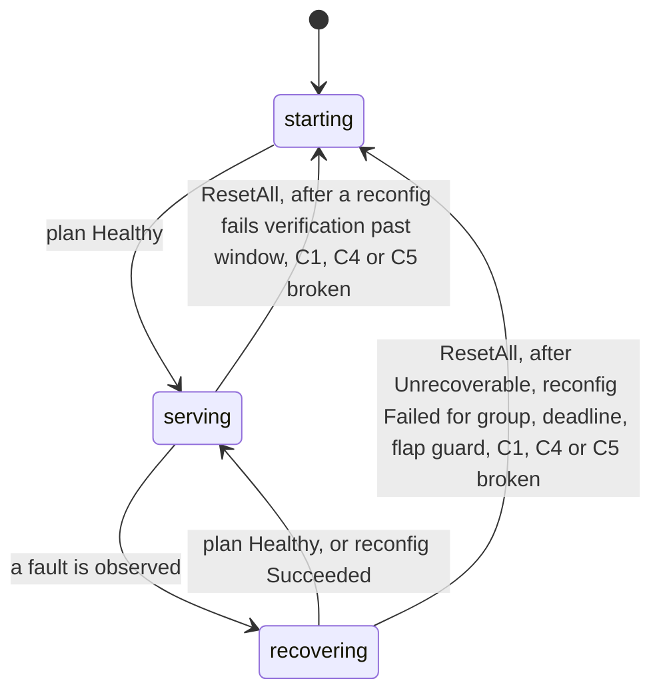
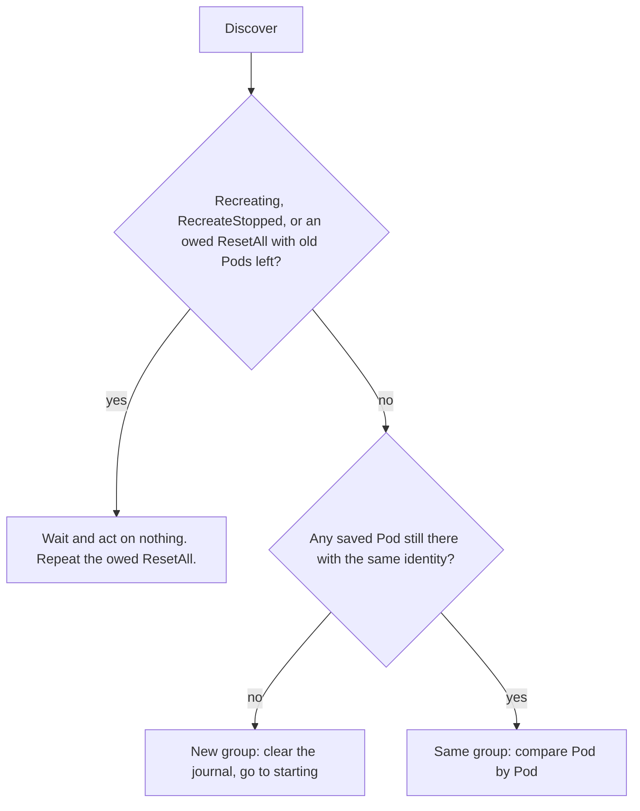
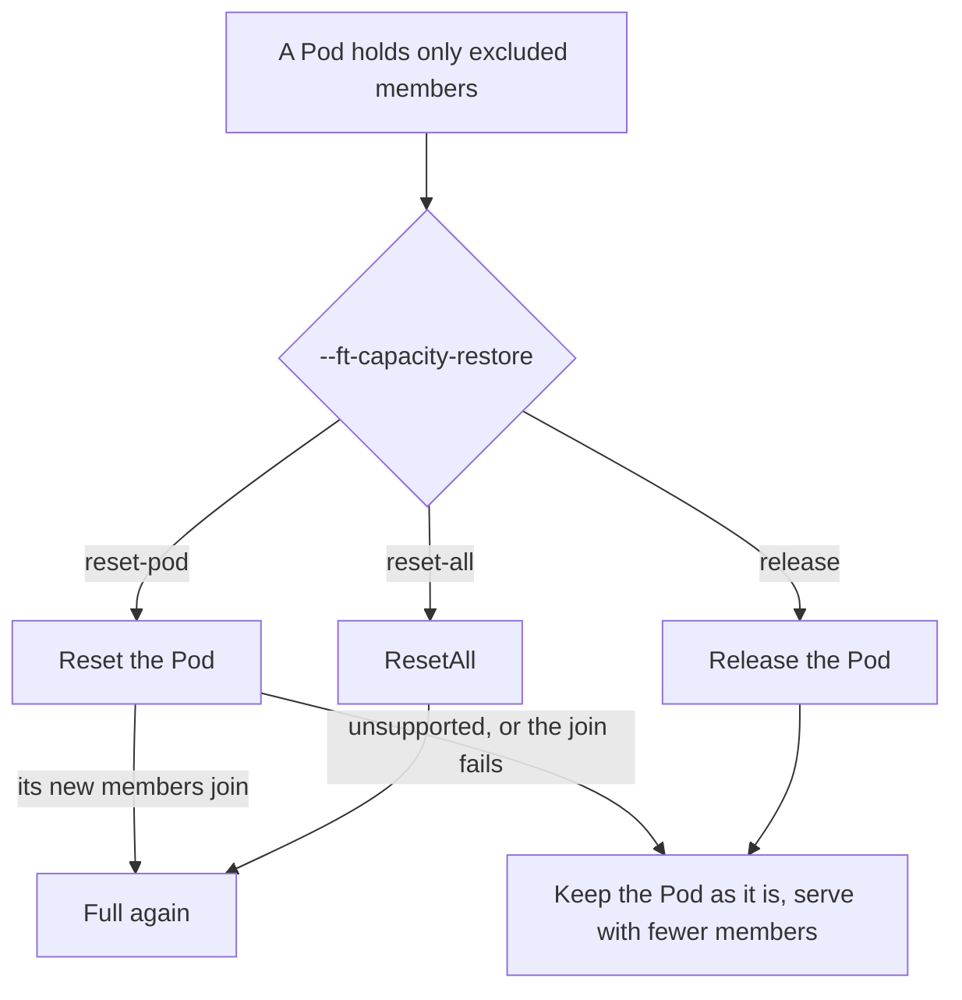

# Controller

The controller runs one loop per engine group, on the elected leader. Every poll it reads the
[workload](workload.md) and the [engine](engine.md), decides what the group needs, and acts.
It owns everything that is not engine- or workload-specific:

- the phases and their deadlines,
- whether it is still the same group,
- connecting Pods to engine members,
- saving state in the [journal](journal.md) before acting,
- resets, and bringing capacity back after a shrink,
- the checks every engine plan must pass.

It reads only the engine-neutral [`Member`](engine.md#objects) fields and [`Pod`](workload.md#objects)
facts. Everything engine-specific stays in the engine.

## Interface

```go
func New(ctx context.Context, workload Workload, engine Engine, journal Journal, recorder Recorder, config Config) (Controller, error)

type Controller interface {
    Step(ctx context.Context) error
}
```

A runner calls `New` until the journal loads, then `Step` every `PollInterval` while this process leads.
`New` and the defaults below come with the implementation; the code defines `Controller` and its objects.

## Objects

```go
// Config holds the controller's settings. Flags are in Configuration below.
type Config struct {
    PollInterval     time.Duration   // 1s
    DiagnosisTimeout time.Duration   // 75s: longest time in recovering without a reconfig
    ApplyTimeout     time.Duration   // 90s: longest time a reconfig may stay in flight
    VerifyTimeout    time.Duration   // 2m: how long a failed check after a reconfig is retried
    FlapWindow       time.Duration   // 2m: check C6
    CapacityRestore  CapacityRestore // reset-pod (default) | reset-all | release
}

type Phase string // starting | serving | recovering

// CapacityRestore says how capacity comes back after a shrink.
type CapacityRestore string // reset-pod | reset-all | release

type MemberState string // candidate | admitted | excluded | rejected

// PodRecord is what the controller remembers about one Pod.
type PodRecord struct {
    Name     string
    Identity string
    Node     string // so an incident can name the node of a Pod that is already gone
    Removing bool   // asked to go, through Reset, ResetAll or Release
}

// Record is the controller's whole state. It is what the journal stores.
type Record struct {
    Phase   Phase
    Since   time.Time // when the phase started. The diagnosis deadline counts from here.
    Reason  string

    Pods    map[string]PodRecord     // by UID. Also what ResetAll names.
    Members map[MemberID]MemberState

    Reconfig       *Reconfig    // in flight, nil when none
    ReconfigSince  time.Time // the apply deadline counts from here
    Acceptances []Acceptance
    Verifying   []MemberID // members of a reconfig that succeeded, not yet checked with Verify

    LastNoChangeReconfig         time.Time // check C6
    VerifyFailedSince         time.Time
    DiscoveryUnavailableSince time.Time
    RecreateStopped           bool // from the last Discover, so people can see the workload gave up

    Incident *Incident // the open incident, nil when none. Closed ones go to telemetry.
}
```

`Reconfig`, `Acceptance` and `MemberID` come from the [engine](engine.md#objects). `Incident` comes from [telemetry](telemetry.md#objects).

## Functions

### New

Builds the controller and loads its state.

| | |
|---|---|
| **Input** | a [`Workload`](workload.md#interface), an [`Engine`](engine.md#interface), a [`Journal`](journal.md#interface), a [`Recorder`](telemetry.md#interface), a [`Config`](#objects) |
| **Output** | a `Controller`, or an error |
| **Side effects** | `Journal.Load` |

**Examples.**

```go
New(...) // empty journal (first run):       Record{Phase: starting}
New(...) // leader changed during a reconfig:   Record{Phase: recovering, Reconfig: iro-ft-7c1e, ...}. The next Step watches Progress; it never resends.
New(...) // journal unreadable or not valid: error. The runner logs it and calls New again next poll.
New(...) // a phase this version does not know: starts over, as with an empty journal.
```

### Step

Runs one reconciliation: read, decide, act.

| | |
|---|---|
| **Input** | none |
| **Output** | `nil`, or an error that the runner logs. An error before a save leaves the saved state as it was. A workload call that fails after its save is repeated on the next poll, and its error is returned once the step has saved. |
| **Side effects** | any of `Journal.Save`, `Probe`, `Apply`, `Verify`, `Reset`, `ResetAll`, `Release`, and [`Recorder`](telemetry.md#interface) calls for what happened |

In order:

1. **Discover.** If it fails, keep the phase and its deadline clock, note the time, and stop here.
2. **Read Discover** against the journal: same group, new group, or going away. While the old group is going,
   repeat any owed `ResetAll` and stop here. See [Reading Discover](#reading-discover).
3. **If `starting`**, record the Pods, `Observe`, and ask for a `Plan` over the members that are not Terminal.
   Wait while a Pod is `Starting` or gives no members. On a `Healthy` plan, admit every member and go to
   `serving`. Stop here: no member is admitted yet, so there is nothing to check.
4. **Observe** the Pods and [connect members to Pods](#connecting-pods-and-members).
5. **Check the observation** (C1, C4, C5). A violation resets the group.
6. **Act by phase.** Ask the policy for a `Plan`, or for `Progress` when a [reconfig](#reconfigs) is in flight.
   Check and send a new reconfig, verify the members of a reconfig that succeeded, or reset.
7. **[Restore capacity](#restoring-capacity)** if the group is `serving`.

**Example**, the [running example](README.md#running-example) poll by poll:

| Poll | Discover | Observe | Policy says | Controller does | Phase, reconfig |
|---|---|---|---|---|---|
| 1 | 4 Pods `Ready` | all `Serving` | `Plan`: Healthy | nothing | serving |
| 2 | same | `dp3` Terminal, `dp0`-`dp2` paused | `Plan`: Change, remove `dp3@idD` | enters `recovering`, saves, calls `Probe` once | recovering |
| 3 | same | same | same | waits: under 2 polls in `recovering` | recovering |
| 4 | same | same | same | checks C1-C7, saves reconfig `iro-ft-7c1e`, `Apply`, saves acceptances | recovering, reconfig in flight |
| 5 | same | survivors rebuilding | `Progress`: Running | waits, under the apply deadline | recovering, reconfig in flight |
| 6 | same | `dp0`-`dp2` healthy | `Progress`: Succeeded | marks `dp3@idD` excluded, clears the reconfig, `Verify(dp0, dp1, dp2)` | serving |
| 7 | same | same | `Plan`: Healthy | `lws-0-3` holds only excluded members: marks it `Removing`, saves, `Reset(lws-0-3, d1)` | serving |
| 8 | `lws-0-3` (d1) Terminating | `dp0`-`dp2` Serving | `Plan`: Healthy | waits | serving |
| 9 | `lws-0-3` (d2) Starting | same | `Plan`: Healthy | saves the new Pod, forgets d1 and `dp3@idD`. No deadline. | serving |
| ... | `lws-0-3` (d2) Ready | `dp3` on d2 Joinable | `Plan`: Change, add `dp3@idD2` | checks, saves reconfig, `Apply` | serving, reconfig in flight |
| ... | same | `dp3@idD2` healthy | `Progress`: Succeeded | marks `dp3@idD2` admitted, `Verify(dp3@idD2)` | serving |

The [`Record`](#objects) after poll 5, as the journal stores it and `Recorder.Stepped` receives it:

```yaml
Phase: recovering
Reason: "dp3 is dead; survivors paused"
Reconfig: {ID: iro-ft-7c1e, Participants: [dp0@idA, dp1@idB, dp2@idC], Remove: [dp3@idD]}
Members: {dp0@idA: admitted, dp1@idB: admitted, dp2@idC: admitted, dp3@idD: admitted}
RecreateStopped: false
```

## Behavior

### State machine



Three phases, none terminal. A reset is not a phase either: `ResetAll` marks every saved Pod `Removing`
and the group goes to `starting`, which waits until the old Pods are gone (see [Reading Discover](#reading-discover)). Whether a reconfig is in flight is not a phase; it is the `Reconfig` field,
described [below](#reconfigs). A reconfig can run in `recovering` (fixing a fault) or in `serving` (bringing a Pod's members back).

| Phase | Meaning | Controller does | Leaves when |
|---|---|---|---|
| `starting` | a new group, or the old one is being reset | while old Pods remain, repeats any owed `ResetAll` and acts on nothing. Then records the Pods every poll, checks nothing, waits for a `Healthy` plan and ignores any other plan. No deadline: the workload's startup probe owns that, and the workload decides how fast to recreate the group, and whether to stop. | plan `Healthy` |
| `serving` | healthy, maybe below full | verifies the members of a reconfig that just succeeded, plans every poll, and [restores capacity](#restoring-capacity). A reconfig that admits candidates runs here. | a fault |
| `recovering` | the engine reports a fault | probes once on entry. Without a reconfig: plans every poll, resets on `Unrecoverable`, and sends a reconfig no sooner than 2 polls in. With a reconfig: checks `Progress` every poll and never sends it again. | `Healthy` plan, or reconfig `Succeeded`. Or reset. |

In `serving`, a `Healthy` plan is fine and a `Change` that only adds members is a reconfig to grow back.
Any other plan is a fault.

### Reading Discover

The workload only reports Pods as they are now. The controller decides what they mean by comparing
them with the Pods saved in its journal.



| Pod compared with the journal | Meaning | Controller does |
|---|---|---|
| saved, same identity, not `Terminating` | unchanged | nothing |
| saved as `Removing`, now gone or `Terminating` | the `Reset` or `Release` is happening | forgets it once it is gone |
| saved, not `Removing`, now gone, `Terminating` or with a new identity | its members are lost | adds them to the observation as Terminal ([lost members](engine.md#observe)), so the policy plans as usual and a reconfig can remove them |
| not saved, `Starting` | a replacement Pod is loading | saves it and waits |
| not saved, `Ready` | a replacement Pod is up | its members, as `Observe` reports them, are candidates |

A `ResetAll` is owed when every saved Pod is `Removing`. Once none of them remain, the first check
fails, the second finds no saved Pod, and the new Pods form a new group.

While `starting`, every Pod belongs to the group being started. The controller records the Pods again on
every poll and does not connect or check members. On the first `Healthy` plan it admits every member it saw.
The table above, [connecting Pods and members](#connecting-pods-and-members) and checks C1, C4 and C5 apply
from then on. An empty journal (IRO's first run) is a new group.

### Connecting Pods and members

`Discover` reports Pods. `Observe` reports members, each with the Pod it runs on. The controller joins
the two by `Member.ID()` (`dp3@idD`) and keeps each ID as candidate, admitted, excluded or rejected.
Excluded means a reconfig removed it, and its Pod may still be reset. Rejected means it stays out until the
next group: a candidate that could not join, or an excluded member whose Pod is kept as it is.

| Case | Controller does |
|---|---|
| member reported on a saved Pod | matches it by ID |
| member reported on a new, `Ready` Pod | records it as a candidate |
| admitted member not reported (its Pod is unreachable) | treats it as unknown: not Serving, not Terminal |
| admitted member on a Pod that is gone, `Terminating` or has a new identity (replaced, or its engine restarted) | lost: added to the observation as Terminal, `Detail: "pod lost"` |

### Reconfigs

A reconfig is the one engine action IRO can have in flight. It is saved in the journal before it is
sent, and cleared when `Progress` reports `Succeeded` or `Failed`.

| | No reconfig in flight | Reconfig in flight |
|---|---|---|
| Asks the policy | `Plan` | `Progress` |
| Deadline | `DiagnosisTimeout`, from the fault | `ApplyTimeout`, from `ReconfigSince` |
| Members in `Remove` | admitted | still fenced: they must reach Terminal (C1, C4) |
| After a leader change | plans again | watches `Progress`. Never sends the reconfig again. |

The two deadlines catch different hangs: an engine that never reaches a state IRO can act on,
and a reconfig that never finishes. While the workload reports `Recreating`, deadlines are not checked, and
both restart when it ends, and when a new leader takes over. A new group drops the reconfig in flight: the workload is already replacing everything.

**After a reconfig succeeds**, the controller saves its participants and joiners in `Verifying` and calls
`Verify` on them. A failure is retried for `VerifyTimeout`; then the group is reset (reason `verify_failed`).
A new leader finds `Verifying` in the journal and continues the check. Verify runs only here: IRO checks
what it changed, nothing else. A fresh group, or one that recovered without a reconfig, goes to `serving`
on a `Healthy` plan.

### Restoring capacity

Capacity never comes from new Pods. It comes back by resetting the failed Pod, or the whole group.
This runs only while the group is `serving`; a fault comes first.



1. Once the members of the last reconfig passed `Verify`, on a poll whose plan is `Healthy`, the controller
   looks for Pods that hold only excluded members. It marks them `Removing`, saves, and calls `Reset`,
   `ResetAll` or `Release`, per `--ft-capacity-restore` (C8). A Pod that is already gone is just forgotten.
2. After a `Reset`, the new Pod's members are candidates. The policy admits them in an ordinary [reconfig](#reconfigs).
3. There is one try, no budget. If the Pod cannot be reset (`ErrUnsupported`, or the engine cannot grow),
   or the new Pod's members are rejected (the join reconfig fails, or the new Pod restarts before joining),
   the group keeps serving with fewer members. The Pod's members are marked rejected, so it is not tried
   again. A new Pod that is still starting is waited for.
4. With `release`, the released Pod goes and the group serves with fewer members. `ErrUnsupported` keeps
   the Pod as it is, the same way.
5. With `reset-all`, any excluded or rejected member resets the whole group (reason `capacity`), even when
   its Pod still holds admitted members, so the group never stays below full.
6. Other workload errors are not failures: the call is repeated on the next poll.
7. Full capacity comes back with the next group: any `ResetAll`, or a recreation by the workload.
8. There is no extra state: the `Removing` Pods, the member states and the reconfig in flight say where things are.

## Rules

### Checks on every plan

The policy decides. The controller still refuses any plan that breaks these rules,
so a wrong policy can stall or reset a group but cannot exclude a member that still serves.

| # | Rule | Why |
|---|---|---|
| C1 | `Remove` holds only members that are Terminal, and they stay Terminal until the reconfig succeeds | the router follows native health. A removed member that still serves gets traffic outside the group. |
| C2 | `Add` holds only candidates that are Joinable, on Pods that are `Ready` and unchanged | a stale Pod must not join |
| C3 | `Participants` and `Remove` are admitted members, `Add` holds candidates, the three are disjoint, and `Participants` is not empty | a reconfig must name a real, consistent membership change |
| C4 | Excluded members stay Terminal | otherwise an excluded member could take traffic again |
| C5 | Members that are not admitted are not Serving, except those the reconfig in flight adds | a joiner must not take traffic before it is in the group |
| C6 | A reconfig that changes no membership cannot repeat within `FlapWindow` | stops retry loops |
| C7 | One reconfig at a time. Every member a reconfig names is in the observation it is planned on, lost members included. `Apply` refuses any other reconfig. | a stale reconfig cannot apply to a changed group |
| C8 | `Reset` and `Release` name only Pods whose every member is excluded, after the reconfig that removed them finished | the engine must no longer depend on a Pod before it goes |

A plan that fails C1 to C3 resets the group. An observation that fails C1, C4 or C5 resets the group.
The observation is checked in `serving` and `recovering`. In `starting` no member is admitted yet: the
`Healthy` plan that ends `starting` admits them all. C8 limits what the controller itself sends, so it is
never violated at runtime.

### Guarantees

| Guarantee | How |
|---|---|
| One writer per group | runs only on the elected leader. Journal saves are compare-and-swap. |
| At-most-once reconfigs | the reconfig is saved before `Apply`. A new leader only watches `Progress`. |
| Repeatable workload calls | `Reset`, `ResetAll` and `Release` are saved first and repeated until `Discover` shows the result |
| One reconfig at a time | a new plan is asked for only when no reconfig is in flight |
| Faults come first | capacity is restored only while `serving` |
| A failed save never advances the phase | the in-memory state keeps the last saved phase |
| Never resets a group it cannot see | discovery failures wait |
| Resets hit only what failed | `Reset` names one Pod by UID; `ResetAll` names the saved Pods by UID. Both are repeated until those Pods are gone. |
| Never gives up on its own | no reset budget and no terminal phase. The workload's restart policy paces resets and decides when to stop. |
| No startup deadline | `starting`, and a reset Pod coming back, take as long as they need |

## Configuration

| Flag | Default | Meaning |
|---|---|---|
| `--enable-engine-ft` | `false` | turn the controller on (needs `--leader-elect`) |
| `--engine` | | engine implementation, e.g. `vllm` |
| `--workload` (target) | `lws` | workload implementation |
| `--ft-diagnosis-timeout` | 75s | `DiagnosisTimeout` |
| `--ft-apply-timeout` | 90s | `ApplyTimeout` |
| `--ft-verify-timeout` | 2m | `VerifyTimeout`: how long a failed check after a reconfig is retried. 0 resets on the first failure. |
| `--ft-capacity-restore` (target) | `reset-pod` | `CapacityRestore`: `reset-pod` resets the failed Pod once and serves below full if that fails; `reset-all` resets the group, so it never stays below full; `release` frees the GPUs and serves below full. |
| no flag | 2m | `FlapWindow` |
| no flag | 1s | `PollInterval` |

Each engine and workload implementation registers its own flags.
`--ft-store-port` moves to the engine driver that needs it.

## Considerations

- **Discovery fails.** A failed read does not prove the group changed, so the controller keeps the
  phase and its deadline clock and never resets on it.
- **The workload gave up.** `RecreateStopped` makes the controller wait and act on nothing. Telemetry
  reports it so people can see it. Recovery resumes when the workload recreates the group.
- **Why verify only after a reconfig.** Verify does not gate traffic: the router follows the engine's native
  health. Its job is to catch a recovery the engine reports as done but that cannot generate. That risk
  comes from what IRO changed, so that is when it checks. One slow completion is not a fault, so a failure
  is retried for `VerifyTimeout` before the reset.
- **No give-up state.** IRO resets whenever recovery in place cannot help. How often a group may be
  recreated, and when to stop, is the workload's restart policy (LWS `restartBackoff`, `maxGroupRestarts`).
- **Why the controller decides "same group".** It already remembers which Pods it asked to reset or
  release, so it can tell those from a lost one. The workload stays a plain reporter.
- **Why reset one Pod first.** It is the smallest action that brings capacity back: only the failed Pod
  restarts, and the other members keep serving. `ResetAll` stops the whole group while the model loads
  again, and when this group is the only one serving the model, that is a full outage. So when the Pod
  cannot come back, the default keeps serving with fewer members. `--ft-capacity-restore=reset-all` takes
  the outage to get back to full.
