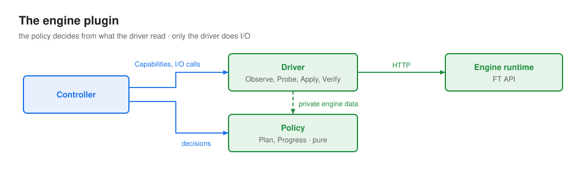

# Engine

One plugin per inference engine. It has two halves:

- **Driver** does I/O. It reports which members run on each Pod and their state, sends recovery
  reconfigs and runs inference probes. It keeps no memory.
- **Policy** decides. Given what the driver saw, it says which members should leave or join, and how
  the reconfig in flight is going. It does no I/O.

The engine never talks to the workload, and knows nothing about phases, deadlines or Kubernetes.
The first implementation, vLLM, comes with its own PR and doc.



## Interface

```go
type Engine interface {
    Capabilities() Capabilities
    Driver
    Policy
}

type Driver interface {
    Observe(ctx context.Context, pods []Pod) Observation
    Probe(ctx context.Context, observation Observation) error
    Apply(ctx context.Context, observation Observation, reconfig Reconfig) ([]Acceptance, error)
    Verify(ctx context.Context, observation Observation, members []MemberID) error
}

type Policy interface {
    Plan(observation Observation, admitted, candidates []MemberID) Plan
    Progress(observation Observation, reconfig Reconfig) Progress
}
```

`Pod` and `PodRef` come from the [workload](workload.md#objects).

## Objects

```go
// Capabilities says what the engine can do at all.
type Capabilities struct {
    Grow bool // can admit new members into a running group
}

// Member is one engine member (a rank, a worker...) as the driver sees it now.
type Member struct {
    Pod         PodRef
    PodIdentity string // copied from the Pod, so the ID changes when the Pod is replaced or its engine restarts
    Name        string // the engine's name for it, unique within the Pod, e.g. "m3"
    Serving     bool   // the router may send it traffic: the engine's native health
    Terminal    bool   // will never serve again
    Unknown     bool   // the driver could not read it now. Serving, Terminal and Joinable are false.
    Joinable    bool   // for candidates only: can be admitted now
    Detail      string // for status and logs only
}

// MemberID names one engine member in one Pod's life.
type MemberID string

// ID is the same for anyone who computes it: Name@PodIdentity.
func (member *Member) ID() MemberID { return MemberID(member.Name + "@" + member.PodIdentity) }

// Observation is what the driver saw in one Observe call, plus the lost members the controller adds.
type Observation struct {
    Members []Member
    Engine  any // driver-private: addresses and raw state, for the same engine's driver and policy
}

// Reconfig is one recovery or resize action. The controller builds it from a Plan.
type Reconfig struct {
    ID           string     // unique, assigned by the controller
    Participants []MemberID // admitted members that take part
    Remove       []MemberID // admitted members that leave
    Add          []MemberID // candidates that join
}

// Acceptance is one member's answer to Apply. Accepted means "started", not "done".
type Acceptance struct {
    Member   MemberID
    Accepted bool
    Error    string
}

// Plan is the policy's answer to "what now?".
type Plan struct {
    Kind         PlanKind
    Participants []MemberID
    Remove       []MemberID
    Add          []MemberID
    Reason       string
}

type PlanKind string // Healthy | Wait | Change | Unrecoverable

// Progress is the policy's answer to "how is the reconfig going?".
type Progress struct {
    State  ProgressState
    Scope  FailureScope // set when State is Failed
    Reason string
}

type ProgressState string // NotStarted | Running | Succeeded | Failed
type FailureScope string  // Joiners: only the joiners failed | Group: the group may be broken
```

`PlanKind` values:

| Kind | Means | Controller does |
|---|---|---|
| `Healthy` | nothing to do | goes to `serving`, or stays there |
| `Wait` | something is wrong, but the engine needs time | waits, under its deadline |
| `Change` | send this reconfig | checks it, saves it, sends it |
| `Unrecoverable` | recovery in place cannot help | resets the group |

Every `Change` is one of four shapes:

| Change | Remove | Add |
|---|---|---|
| retry | empty | empty |
| shrink | Terminal members | empty |
| grow | empty | Joinable candidates |
| replace | Terminal members | Joinable candidates |

## Functions

All examples use the [example group](../../examples/index.md).

### Capabilities

Says what the engine can do at all.

| | |
|---|---|
| **Input** | none |
| **Output** | [`Capabilities`](#objects) |

**Example.** An engine that cannot admit members into a running group returns `{Grow: false}`. The
controller then never resets a single Pod, since the engine could not re-admit its members. With the default `--ft-capacity-restore`, the group keeps serving with fewer members; with `reset-all`, IRO resets the whole group.

### Observe

Reports the members running on the given Pods and their state.

| | |
|---|---|
| **Input** | `pods []Pod` from [`Discover`](workload.md#discover) |
| **Output** | [`Observation`](#objects). Never fails: a member the driver cannot read is reported `Unknown`, and a Pod whose members it cannot list gives none. |
| **Side effects** | none |

**Example**, right after `m3` dies:

```yaml
Members:
- {Pod: pod-0/a1,   PodIdentity: idA, Name: m0, Serving: false, Terminal: false, Detail: "paused, waiting for instruction"}
- {Pod: pod-1/b1, PodIdentity: idB, Name: m1, Serving: false, Terminal: false, Detail: "paused, waiting for instruction"}
- {Pod: pod-2/c1, PodIdentity: idC, Name: m2, Serving: false, Terminal: false, Detail: "paused, waiting for instruction"}
- {Pod: pod-3/d1, PodIdentity: idD, Name: m3, Serving: false, Terminal: true,  Detail: "dead"}
Engine: <driver-private: API addresses, raw engine status>
```

**Lost members.** When a Pod is gone, `Terminating`, or has a new identity, the driver no longer sees the
admitted members that ran on it. Before it calls `Plan`, `Progress`, `Apply` or `Verify`, the controller adds
each one to `Observation.Members` with its Pod, `PodIdentity` and `Name`, `Terminal: true` and
`Detail: "pod lost"`. `Observation.Engine` holds nothing for them. The policy plans them like any Terminal
member, so a shrink names them in `Remove`. If `pod-3` is deleted, `Observe` returns `m0`-`m2` and the
controller adds `{Pod: pod-3/d1, PodIdentity: idD, Name: m3, Terminal: true, Detail: "pod lost"}`.

### Probe

Nudges the engine to notice a fault it has not seen yet. May do nothing.

| | |
|---|---|
| **Input** | the latest [`Observation`](#objects) |
| **Output** | `nil`, or an error. The controller only adds the error to its reason. |
| **Side effects** | engine-specific, bounded, never user-visible |

**Example.** `m3`'s process has exited, but `m0`-`m2` are idle and still report healthy: they only
notice a dead peer inside a collective operation. The controller calls `Probe(obs)` once when it enters
`recovering`. The driver sends one short completion through a healthy member. The collective fails, and on
the next `Observe`, `m3` is `Terminal` and the others are paused.

### Apply

Sends a reconfig to every participant and joiner.

| | |
|---|---|
| **Input** | the [`Observation`](#objects) the reconfig was planned on, and the [`Reconfig`](#objects) |
| **Output** | one [`Acceptance`](#objects) per member it sent to. An error unless every one accepted. |
| **Side effects** | the engine starts the reconfig. Sent again only when no acceptances were saved (after a leader change, or when the save after `Apply` failed) and `Progress` says `NotStarted`. |

**Example.**

```go
Apply(ctx, obs, Reconfig{
    ID:           "iro-ft-7c1e",
    Participants: []MemberID{"m0@idA", "m1@idB", "m2@idC"},
    Remove:       []MemberID{"m3@idD"},
})
// all accept:  [{m0@idA true} {m1@idB true} {m2@idC true}], nil
// one refuses: [{m0@idA true} {m1@idB false "expected 202, got 409"} {m2@idC true}], error
// pod-3 deleted: obs holds m3@idD as the controller added it, Apply sends to m0-m2 and all accept
```

An error means the reconfig did not start everywhere: `Apply` refused it before sending anything, or some
members refused it. Either way the controller resets the group.

### Verify

Sends one real, bounded inference request through each named member. The controller calls it only
after a reconfig succeeds, for the members that took part or joined.

| | |
|---|---|
| **Input** | the latest [`Observation`](#objects), and the members to check |
| **Output** | `nil` when every member produced tokens. An error naming every member that did not. |
| **Side effects** | a few tokens of inference, marked so they are not counted as user traffic |

**Example.**

```go
Verify(ctx, obs, []MemberID{"m0@idA", "m1@idB", "m2@idC"})
// nil
// or: error "m1@idB: no tokens generated". The controller retries every poll for --ft-verify-timeout, then resets.
```

### Plan

Says what should happen now. Pure: no I/O, no clock.

| | |
|---|---|
| **Input** | the latest [`Observation`](#objects), the admitted members, the candidates |
| **Output** | [`Plan`](#objects) |

**Examples.**

```go
// m3 dead, m0-m2 paused:
Plan(obs, admitted: [m0@idA m1@idB m2@idC m3@idD], candidates: [])
// {Kind: Change, Participants: [m0@idA m1@idB m2@idC], Remove: [m3@idD], Reason: "m3 is dead; survivors paused"}

// later, pod-3 was reset, is back as UID d2, and m3 on it is Joinable (needs Grow):
Plan(obs, admitted: [m0@idA m1@idB m2@idC], candidates: [m3@idD2])
// {Kind: Change, Participants: [m0@idA m1@idB m2@idC], Add: [m3@idD2], Reason: "candidate ready"}

// m2 is unhealthy, but m3 is not dead yet:
// {Kind: Wait, Reason: "waiting for the engine to finish diagnosis"}
```

### Progress

Says how the reconfig in flight is going. Pure: no I/O, no clock.

| | |
|---|---|
| **Input** | the latest [`Observation`](#objects), and the [`Reconfig`](#objects) in flight |
| **Output** | [`Progress`](#objects) |

**Examples**, for reconfig `iro-ft-7c1e`:

```go
// no participant got iro-ft-7c1e yet, and the engine can prove it: {State: NotStarted}
// survivors still rebuilding:             {State: Running}
// m0-m2 healthy, finished iro-ft-7c1e:  {State: Succeeded}
// m1 reports its FT operation failed:    {State: Failed, Scope: Group, Reason: "m1@idB: FT failed: ..."}
// a joiner failed, survivors untouched:   {State: Failed, Scope: Joiners, Reason: "m3@idD2 could not join"}
```

## Rules

### Driver

| Rule | Why |
|---|---|
| Every member names its Pod, the Pod's identity, and a `Name` unique within that Pod | `Member.ID()` changes when the Pod is replaced or its engine restarts, so exclusions and reconfigs name exactly one process |
| No memory. Addresses and anything else the driver needs travel in `Observation.Engine`. | a new leader needs no warm-up. The driver may still cache internally, keyed by Pod identity. |
| Pods that are not `Ready` give members that are not Joinable | a loading Pod is not a candidate yet, and an admitted Pod whose sidecar restarts keeps its members |
| A Pod gives all of its members, or none when the driver cannot list them | the controller admits, at the end of `starting`, exactly the members it saw |
| Once Terminal, never Serving again: later reported Terminal or `Unknown` | the controller's check C4 depends on it |
| A member the driver cannot read is `Unknown`, never Terminal by guess | only a process known to be gone may be removed (C1) |
| `Serving` means what the router uses: the engine's native health | checks C1 and C5 reason about traffic |
| Candidates do not report `Serving` | check C5 |
| The engine reports which reconfig each member is working on | `Progress` can tell its reconfig from another one |
| `Apply` refuses, before sending anything, a reconfig that names a member missing from `Observation.Members`. A `Remove` member needs no driver-private data: a lost one has none. | check C7. A lost Pod, the most common fault, still shrinks in place. |
| A member that already got a reconfig never starts it again, so `Apply` with the same ID is safe to repeat | a new leader may resend a reconfig whose send it cannot confirm, and the old leader's late send may still arrive |
| Every call is bounded by a timeout | a hung engine must not stall the loop |

### Policy

| Rule | Why |
|---|---|
| No I/O, no clock, no globals | the same input gives the same answer on any leader |
| Return `Wait` only for a fault the engine is still working out | the controller owns the deadlines |
| Return `Healthy` while candidates cannot be admitted yet | a candidate waiting to join is not a fault |
| Never return `Healthy` while an admitted member is `Unknown` or missing | the controller treats it as a fault anyway |
| Return `Unrecoverable` when recovery in place cannot help | the controller resets |
| Plan `Add` only if `Capabilities().Grow` | the controller resets a single Pod only when the engine can re-admit its members |
| A plan may remove and add in one reconfig (replace) if the engine supports it | fewer reconfigs during a fault |
| `Change` plans must pass the controller's [checks C1 to C7](controller.md#checks-on-every-plan) | otherwise the controller resets |
| `Progress` stays `Running` until the engine reports a result for this reconfig, or proves no member got it | the apply deadline covers a reconfig that never finishes |
| Return `NotStarted` only when every participant and joiner is observed, could start the reconfig now and has not got it, and the engine would still show a reconfig a member got earlier | otherwise a reconfig that finished before a new fault looks unsent, and sending it again would run it twice |
| `Failed` with scope `Joiners` only when admitted members are untouched | otherwise the group may be broken and must be reset |

## Considerations

- **Why two halves.** The policy is pure, so recovery rules can be tested from recorded observations
  without a cluster, and a new leader reaches the same decision from the same observation.
- **`Serving` is not "healthy".** `Serving` is what the router sees. "Healthy" is the
  policy's `Healthy` plan, which may also use what the router does not see, such as a process that
  already exited.
- **Who connects Pods and members.** The driver only reports. The controller tracks which members are
  candidates, admitted, excluded or rejected, and which Pods to remove.
- **Shrinking needs no capability.** A policy that cannot shrink never plans `Remove`.
- **Container probes.** A probe that restarts an engine container makes its members lost (`Member.ID()`
  changes). The engine doc says which probes cannot fail while a member is paused for recovery, or that none
  may be used.
