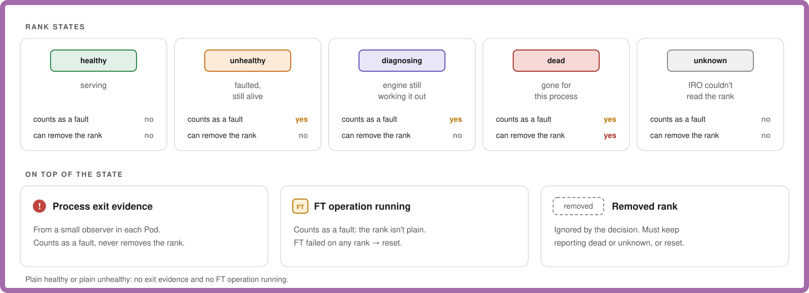
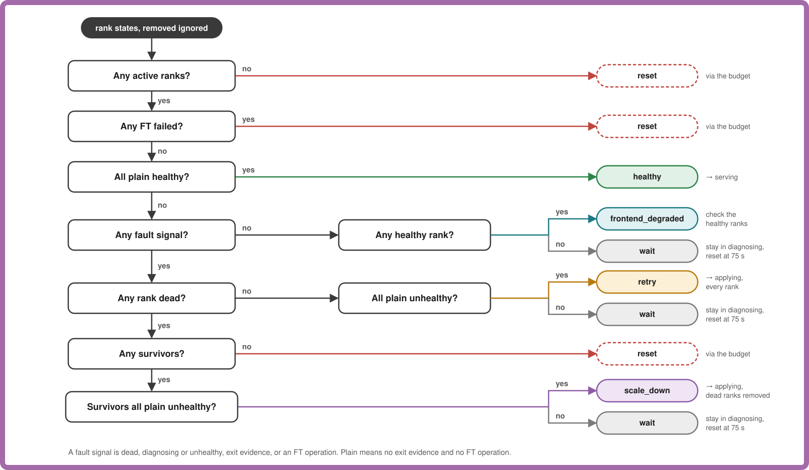
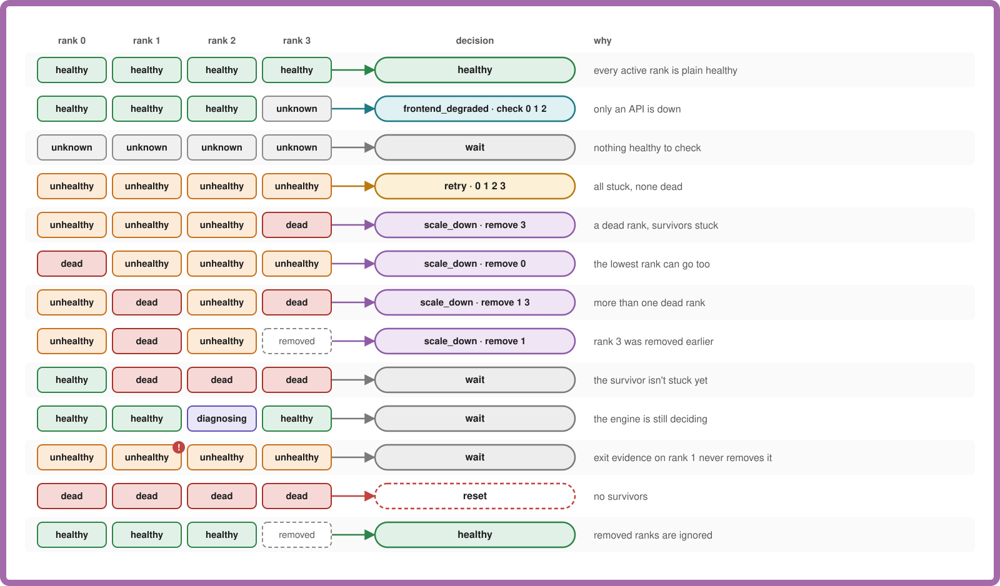

# Engine Fault Decisions

- **Revision**: 1
- **Last Updated**: 2026-10-11

---

In `serving` and `diagnosing`, every tick, the controller turns the rank states
into one action. It's a pure function, `Decide` in
`internal/controller/enginefault/decision.go`: it makes no calls and changes no
state.

## What It Looks At

## How It Decides

Checked top to bottom; the first match wins. Where each outcome leads next is
in the [state machine](engine-fault-state-machine.md).

## Rules

- **Only `dead` removes a rank.** Anything else may still come back, so it gets
  a bounded wait instead.
- **`unknown` doesn't prove engine loss.** It returns `wait`, even when peers
  are healthy. IRO diagnoses without changing membership and resets if the
  diagnosis deadline expires.
- **Survivors must all be plain `unhealthy` before `scale_down`.** Otherwise
  the engine hasn't finished classifying the fault.
- **Capacity is the engine's call.** The engine checks it can still run the
  model when it applies `scale_down`, and a rejection becomes a reset.
- **FT failed on any rank means reset.**

## Examples

These are the cases tested in `TestFaultDecisionsPreserveOriginalMembership`
and `decision_test.go`.
