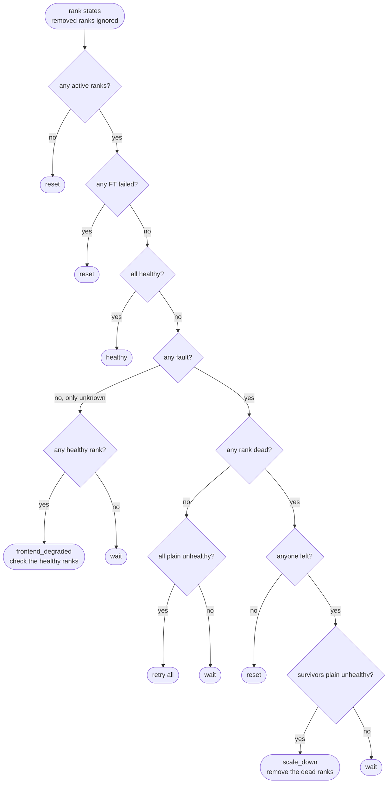
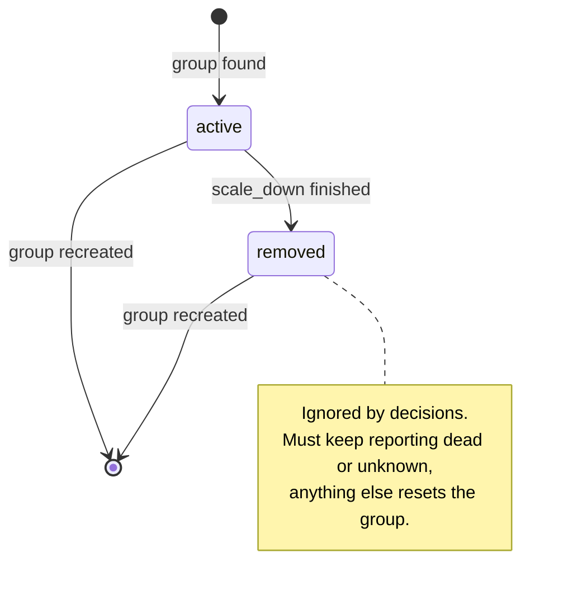

# Engine Fault Decisions

- **Revision**: 1
- **Last Updated**: 2026-10-11
- **PR**: [#11](https://github.com/llm-d-incubation/llm-d-resiliency-operator/pull/11)

---

## Problem

In `serving` and `diagnosing`, the controller looks at every rank and picks one
action: nothing, wait, retry, scale down or reset. A wrong pick is expensive.
Removing a rank that would have recovered costs capacity until the group is
recreated, and waiting too long leaves the group down.

The decision is a pure function (`Decide` in
`internal/controller/enginefault/decision.go`). It makes no calls and changes
no state, so it's easy to test and to reason about.

---

## Inputs

Removed ranks are ignored. For every other rank:

| Rank state | From the engine | Fault? | Can remove the rank? |
| --- | --- | --- | --- |
| `healthy` | serving | no | no |
| `unhealthy` | faulted but alive | yes | no |
| `diagnosing` | still working out the fault | yes | no |
| `dead` | gone for this incarnation | yes | **yes** |
| `unknown` | IRO couldn't read the rank | no | no |

Two extra signals can sit on any rank:

| Signal | Effect |
| --- | --- |
| Process exit evidence (from a per-Pod observer) | Counts as a fault, but never removes the rank. |
| FT operation in progress | Counts as a fault. The rank isn't "plain" healthy or unhealthy. |
| FT operation failed | Reset. |

"Plain" `unhealthy` below means `unhealthy` with no exit evidence and no FT
operation running.

---

## Decision Flow

| Decision | Participants | What happens next |
| --- | --- | --- |
| `healthy` | — | Stay in or return to `serving`, verifying first if needed. |
| `frontend_degraded` | the healthy ranks | Send them a request. Pass: `serving`. Fail: `diagnosing`. |
| `wait` | — | `diagnosing`, reset after 75 s. |
| `retry` | every active rank | `applying` |
| `scale_down` | the survivors | `applying`, the dead ranks are removed when it finishes |
| `reset` | — | Recreate the group. |

---

## Rules

- **Only `dead` removes a rank.** An unreachable API, exit evidence or a stalled
  rank may still come back, so they lead to a bounded wait instead.
- **`unknown` alone isn't a fault.** Losing a rank's API doesn't mean losing its
  engine, so IRO checks the healthy ranks and leaves membership alone.
- **Survivors must all be plain `unhealthy` before `scale_down`.** A survivor
  that is still healthy or diagnosing means the engine hasn't finished
  classifying the fault.
- **Capacity is the engine's call.** IRO doesn't count survivors. The engine
  checks it can still run the model when it applies `scale_down`, and a
  rejection becomes a reset.
- **FT failed anywhere means reset.** The engine tried and gave up.

---

## Rank Membership

Ranks keep their original numbers for the life of the group. A removed rank is
never added back; full capacity returns with the next group.

---

## Examples

H = healthy, U = unhealthy, D = dead, ? = unknown.

| Ranks 0 1 2 3 | Removed | Decision |
| --- | --- | --- |
| H H H H | – | `healthy` |
| H H H ? | – | `frontend_degraded`, check 0 1 2 |
| ? ? ? ? | – | `wait` |
| U U U U | – | `retry` 0 1 2 3 |
| U U U D | – | `scale_down`, remove 3 |
| D U U U | – | `scale_down`, remove 0 |
| U D U D | – | `scale_down`, remove 1 3 |
| U D U ? | 3 | `scale_down`, remove 1 |
| H D D D | – | `wait` |
| H H diagnosing H | – | `wait` |
| U U U U, exit evidence on 1 | – | `wait` |
| D D D D | – | `reset` |
| H H H D | 3 | `healthy` |

These match `TestFaultDecisionsPreserveOriginalMembership` in
`internal/controller/enginefault/controller_test.go` and the cases in
`decision_test.go`.
