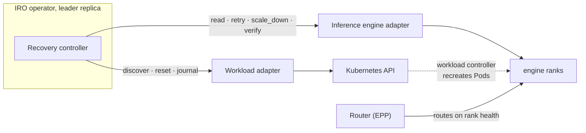

# Engine Fault Recovery Design

- **Revision**: 1
- **Last Updated**: 2026-10-11
- **Proposal**: [IRO proposal](https://docs.google.com/document/d/1Jx2Y3bwwoemy1wk9ZLykPYvPYpVpKDpn/edit)

---

## Problem

Large models are served by groups of engine ranks that depend on each other.
When one rank fails, its Pod often keeps running, so Kubernetes doesn't react.
The other ranks stall and the group stops serving. Recreating the group works,
but every rank reloads the model, which takes minutes.

Engines with a fault-tolerance (FT) API can recover faster: resume stuck ranks
in place, or carry on without the dead ones. Something has to choose the
action, send it to every rank, check the result, and recreate the group when
in-place recovery fails.

### Goals

- Recover in place when the engine can.
- Recreate the group when it can't, with a limit on how often.
- Never act on uncertain evidence.
- Survive operator restarts without repeating an action.
- Work with any engine that implements the [adapter contract](adapters.md).

### Non-goals

- Routing. The router (EPP) owns traffic and reads each rank's own health.
- Adding removed ranks back. Full capacity returns with a new group.
- Node or device repair.

---

## Design Overview



Every second, on the elected operator replica, the controller:

1. finds the group and its ranks (workload adapter),
2. reads each rank's native state (engine adapter),
3. decides what to do,
4. acts, and sends every serving rank a real request before calling the group
   healthy.

### Data flow

```text
Healthy:    discover → read ranks → healthy → nothing to do

Fault:      read ranks → diagnosing → (≥ 2 s) save round → send to ranks → applying
            → participants healthy → verify → serving

Can't fix:  rejected, failed or timed out → save → recreate group → starting → serving
```

### Design rules

| Rule | Why |
| --- | --- |
| Only the engine's own `dead` removes a rank. | A slow or unreachable rank may come back and serve. |
| Save the round before sending it. | A new leader reconciles it instead of sending it twice. |
| A failed Kubernetes read means "don't know". | It never proves the group changed, so it never triggers a reset. |
| `serving` only after a real request succeeds. | Healthy flags alone don't prove the ranks can serve. |
| The router owns traffic. | IRO is never in the request path; serving continues while IRO is down. |
| Resets are limited. | At most 3 in 30 minutes, then a human looks. |

---

## Documents

| Topic | Doc |
| --- | --- |
| States, transitions, timers | [State machine](engine-fault-state-machine.md) |
| Rank states to action | [Decisions](engine-fault-decisions.md) |
| Engine and workload contracts | [Adapters](adapters.md) |
| Journal, leader election, restarts | [Journal and failover](journal-and-failover.md) |
| LWS specifics | [LeaderWorkerSet workload](../workloads/lws.md) |
| Running it | [Operations](../operations.md) |

---

## Risks and Mitigations

| Risk | Mitigation |
| --- | --- |
| Removing a rank that's only slow | Only native `dead` removes. Everything else waits, then resets. |
| Two operators act on one group | Leader election. Journal writes can't overwrite newer ones. |
| Reset loops | 3 resets in 30 minutes, then `intervention_required`. |
| Deleting the wrong Pod | A reset deletes only the recorded leader Pod, by UID. |
| Kubernetes or observer outage | No action on failed reads. Escalate after 10 minutes. |
| Capacity quietly shrinks | Removed ranks stay out until the group is recreated. No alert yet. |

---

## Implementation Plan

### First version

The recovery controller, the engine contract with an adapter registry, and the
LWS workload adapter. Opt-in with `--enable-engine-ft`.

### Follow-ups

- Events and metrics for state, removed ranks and resets.
- A startup timeout flag, and letting a slow group recover from
  `intervention_required`.
- Keep in-memory state unchanged when a journal write fails.
- A Lease named after the group, for one IRO per LWS.
- A first engine adapter in the registry.
- More than one group per LWS.
