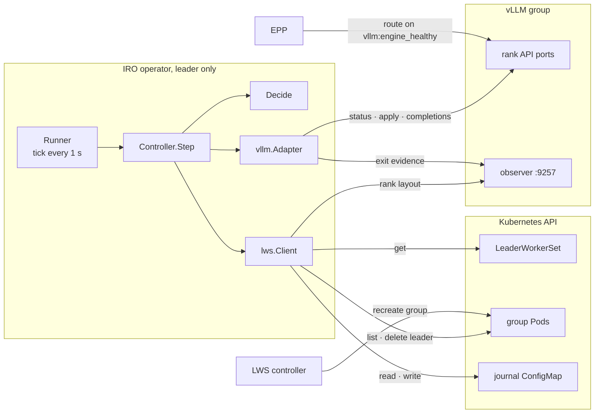
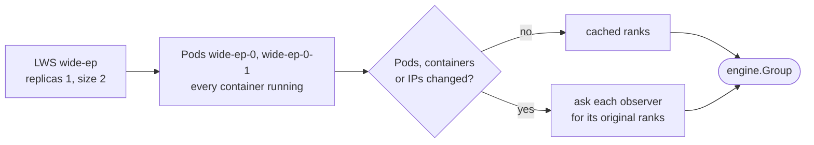
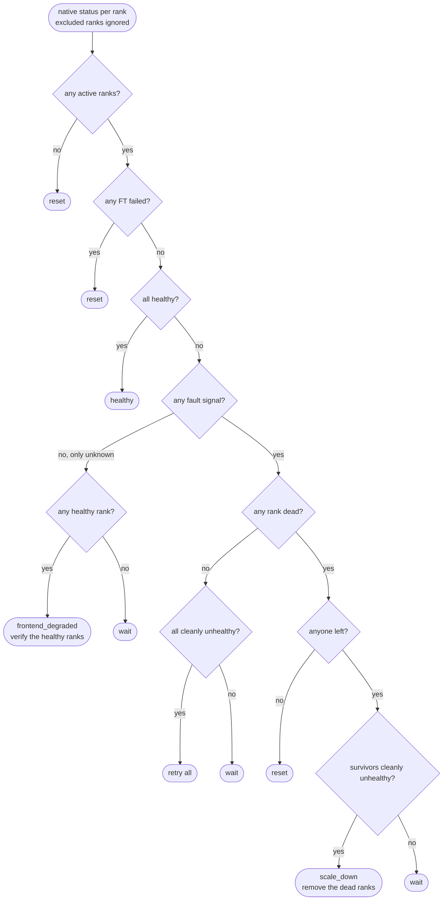
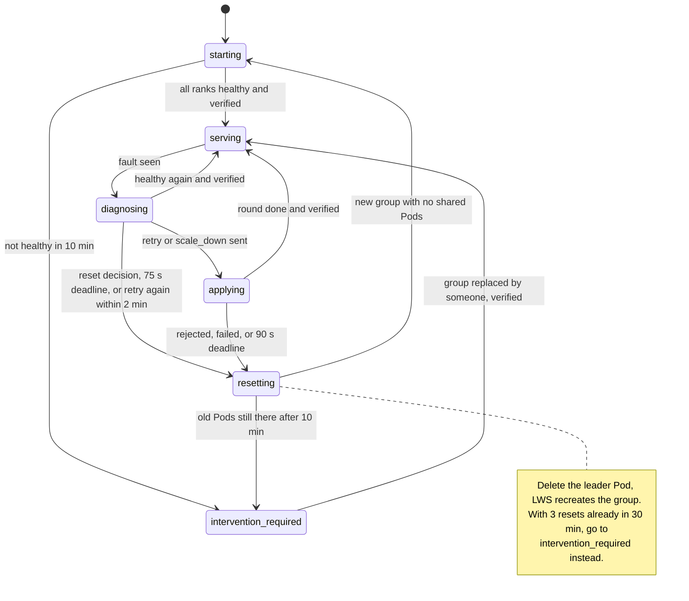
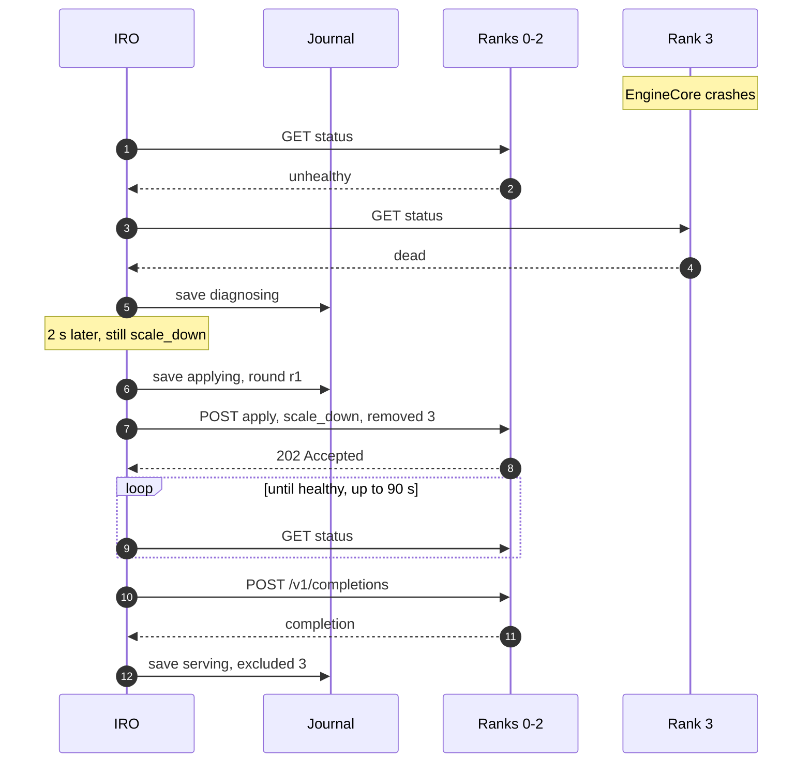
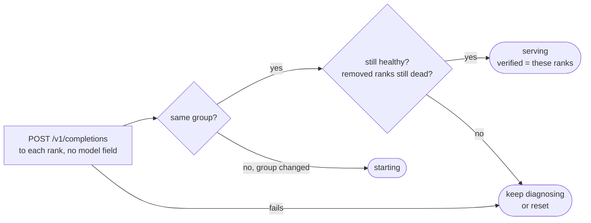
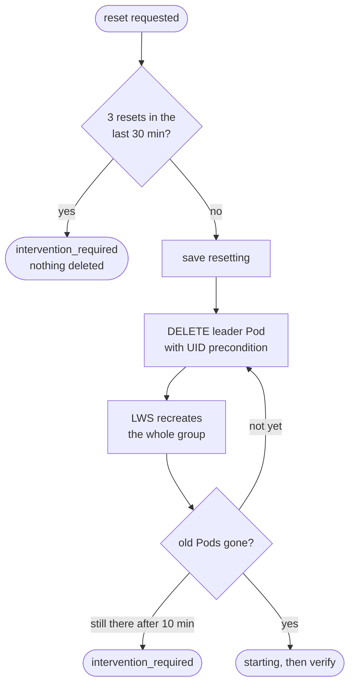
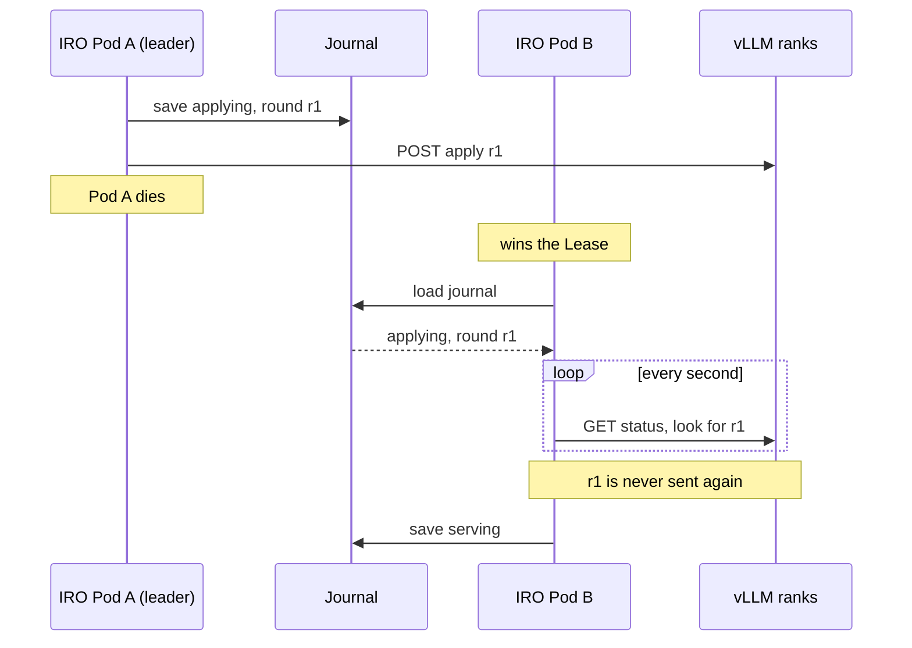

# vLLM Engine Fault Recovery Design

- **Revision**: 1
- **Last Updated**: 2026-10-11
- **PR**: [#11](https://github.com/llm-d-incubation/llm-d-resiliency-operator/pull/11)
- **Proposal**: [IRO proposal](https://docs.google.com/document/d/1Jx2Y3bwwoemy1wk9ZLykPYvPYpVpKDpn/edit)

---

## Problem

A wide-EP vLLM deployment runs as one LeaderWorkerSet (LWS) group. When one
engine fails, its Pod usually keeps running, so LWS doesn't react. The other
ranks block on the dead peer and the whole group stops serving.

Recreating the group fixes it, but every rank reloads the model, which takes
minutes. vLLM's fault-tolerance (FT) API can do better: resume stuck engines in
place (`retry`) or carry on without the dead ones (`scale_down`). Something has
to pick the action, send it to every rank, check that it worked, and recreate
the group when it didn't. This feature adds that to IRO.

### Scope

- One LWS group (`replicas: 1`) with `RecreateGroupOnPodRestart`, TP=1.
- vLLM with the FT API and native per-rank health, plus the
  [runtime bridge](../../runtime/vllm/README.md) in every Pod.
- Opt-in with `--enable-vllm-ft`, which also needs `--leader-elect`.
- One IRO per LWS. RecoveryRequest behaviour is unchanged.
- Not covered: routing (EPP owns it), adding ranks back after `scale_down`,
  node repair, more than one group per LWS.

---

## Design Overview



Every second the elected operator:

1. finds the group's ranks (Kubernetes plus a small observer in each Pod),
2. reads each rank's native FT status from vLLM,
3. decides: nothing, wait, `retry`, `scale_down` or reset,
4. acts, and proves recovery with a real completion before calling the group
   healthy again.

Progress is kept in a ConfigMap, so a new leader picks up where the old one
stopped. EPP keeps routing on vLLM's own `vllm:engine_healthy` metric the whole
time. IRO is never in the request path, and healthy traffic keeps flowing while
IRO is down.

### Data flow

```text
Healthy tick:
  Discover → GET status ×N → Decide = healthy → nothing to do

Recoverable fault:
  tick 1   Decide = scale_down   → diagnosing (saved)
  ≥ 2 s    still scale_down      → save round as applying → POST apply to survivors
  later    survivors healthy     → exclude dead ranks → POST completions → serving (saved)

No way back:
  rejected, failed or timed out  → save resetting → DELETE leader Pod → LWS recreates group
```

---

## Mechanism 1: Finding the ranks



```text
group id  sha256 of LWS UID + Pod UIDs + container IDs + restart counts
rank 0    http://10.0.0.10:8000   wide-ep-0
rank 1    http://10.0.0.10:8001   wide-ep-0
rank 2    http://10.0.0.11:8000   wide-ep-0-1
rank 3    http://10.0.0.11:8001   wide-ep-0-1
```

- Ranks keep their original numbers for the life of the group, even after
  others are removed.
- The group ID changes when any Pod or container is replaced. That's how IRO
  notices a new group.
- The observer is only needed the first time. The layout stays cached until a
  Pod, container or IP changes, so a dead observer doesn't block recovery.
- A failed read means "don't know", never "the group changed".

---

## Mechanism 2: Deciding what to do



A fault signal is `dead`, `diagnosing` or `unhealthy`, observer exit evidence,
or an FT operation in progress. "Cleanly unhealthy" means `unhealthy` with no
exit evidence and no FT operation running.

The one hard rule: **only vLLM's own `dead` status removes a rank.** An
unreachable API, observer evidence or a survivor mask never does. They lead to
a bounded wait and then a reset if nothing clears up. IRO doesn't check expert
capacity itself. vLLM does that when it applies `scale_down`, and a rejection
turns into a reset.

---

## Mechanism 3: Phases and deadlines



A removed rank coming back resets from any phase. A group replaced behind
IRO's back sends it to `starting`. Ten minutes without
a successful Kubernetes read ends in `intervention_required`. Nothing is
deleted on the way into `intervention_required`; IRO waits for someone to
replace the group.

| Timer | Default | Configurable | Bounds |
| --- | --- | --- | --- |
| Tick | 1 s | no | How often the loop runs. The first action waits at least 2 s into diagnosis. |
| Diagnosis | 75 s | `--vllm-diagnosis-timeout` | Time in `diagnosing`. |
| Apply | 90 s | `--vllm-apply-timeout` | Time for a sent round to finish. |
| Startup | 10 min | no | Group start-up, old Pods leaving, Kubernetes outage. |
| Retry window | 2 min | no | A second `retry` inside it resets instead. |
| Reset budget | 3 per 30 min | no | Then `intervention_required`. |

---

## Mechanism 4: Recovery rounds



- A round names original ranks and carries one request ID for every
  participant. Every participant has to answer 202, or the group is reset.
- The round is saved before it's sent. After a restart it's checked against
  vLLM's status, never sent twice.
- `retry` is the same flow with every active rank and nothing removed.
- Removing the lowest active rank also moves the FT store: the round adds
  `dp_master_ip` (the first survivor's host) and `dp_store_port`.
- A removed rank never comes back in place. It must stay `dead`; if it shows up
  alive, the group is reset. Full capacity returns with the next new group.

### Proving recovery



`verified` in the journal is a record, not a gate. EPP can send traffic to a
rank as soon as vLLM reports it healthy, before IRO finishes checking.

---

## Mechanism 5: Recreating the group



Reasons to reset: vLLM reports FT failed, nothing survives, a round is rejected
or doesn't finish in 90 s, diagnosis takes over 75 s, a second `retry` comes
within 2 minutes, a removed rank comes back, or verification fails. The UID
precondition means a repeated delete can never hit the new leader Pod.

---

## Mechanism 6: Journal and failover



The journal is the ConfigMap `<lws>-ft-state`, key `state.json`. Trimmed
example while a round is in flight:

```json
{
  "phase": "applying",
  "round": {
    "id": "iro-ft-5b1e0c27",
    "group_id": "4e1fa2c9",
    "participants": [0, 1, 2],
    "removed": [3]
  },
  "instruction": "scale_down",
  "since": "2026-10-11T09:14:09Z",
  "reason": "native terminal dead ranks cannot resume serving"
}
```

- Nothing is written on healthy ticks.
- Writes use the ConfigMap's `resourceVersion`, so an older writer can't
  overwrite a newer one.
- Deadlines are timestamps in the journal, so a failover doesn't extend them.
- Only one replica runs the loop. The manager's Lease
  (`llm-d-resiliency-operator-leader`) picks the leader, and losing it stops
  the process.

---

## Configuration

| Flag | Default | Notes |
| --- | --- | --- |
| `--enable-vllm-ft` | `false` | Turns the feature on. Needs `--leader-elect`. |
| `--vllm-lws` | none | LWS name. Required. |
| `--vllm-namespace` | `default` | LWS namespace. The journal lives here too. |
| `--vllm-api-port` | `8000` | Port of local rank 0. Local rank `i` uses `8000 + i`. |
| `--vllm-observer-port` | `9257` | Observer port in each Pod. |
| `--vllm-ft-store-port` | `29600` | FT store port used when the store master is removed. |
| `--vllm-diagnosis-timeout` | `75s` | See Mechanism 3. |
| `--vllm-apply-timeout` | `90s` | See Mechanism 3. |

RBAC for one LWS is in [`deploy/vllm-ft/access.yaml`](../../deploy/vllm-ft/access.yaml).

---

## Risks and Mitigations

| Risk | Mitigation |
| --- | --- |
| Two coordinators act on the same group | Leader election. Journal writes use `resourceVersion`. Gap: a failed write still updates memory, and the reset path can delete again without a saved write. |
| Removing a rank that is only slow or unreachable | Only native `dead` removes a rank. Everything else waits, then resets. |
| A removed process comes back | Checked every tick. The group is reset. |
| Reset loops | 3 resets per 30 min, then `intervention_required`. |
| Deleting the wrong Pod | The delete carries the leader's UID as a precondition. |
| Kubernetes API or observer outage | No reset on a failed read. Cached layout. `intervention_required` after 10 min. |
| Operator restarts mid-round | Round saved before sending, reconciled after restart, never re-sent. |
| Model takes longer than 10 min to load | Not handled yet. The group ends in `intervention_required` and stays there. |
| Running degraded without anyone knowing | Not handled yet. No Events or metrics. |
| Several IRO instances in one namespace | Not handled yet. They share one Lease name. |

---

## Implementation Plan

### PR #11: Engine fault recovery

Adds the leader-only loop, the vLLM and LWS adapters, the runtime bridge and
the deploy overlay. Off by default.

### Follow-ups

- Events and metrics for phase, active and excluded ranks, and resets. Today
  the journal is the only signal.
- A `--vllm-startup-timeout` flag, and letting a slow-starting group go back
  to serving instead of staying in `intervention_required`.
- Don't update memory when a journal write fails, and reload after a conflict.
- A Lease per LWS in the LWS namespace, and a switch to turn off the
  RecoveryRequest controller, so several per-LWS instances can run side by
  side.
- Parallel verification for large EP groups.
- More than one group per LWS.
