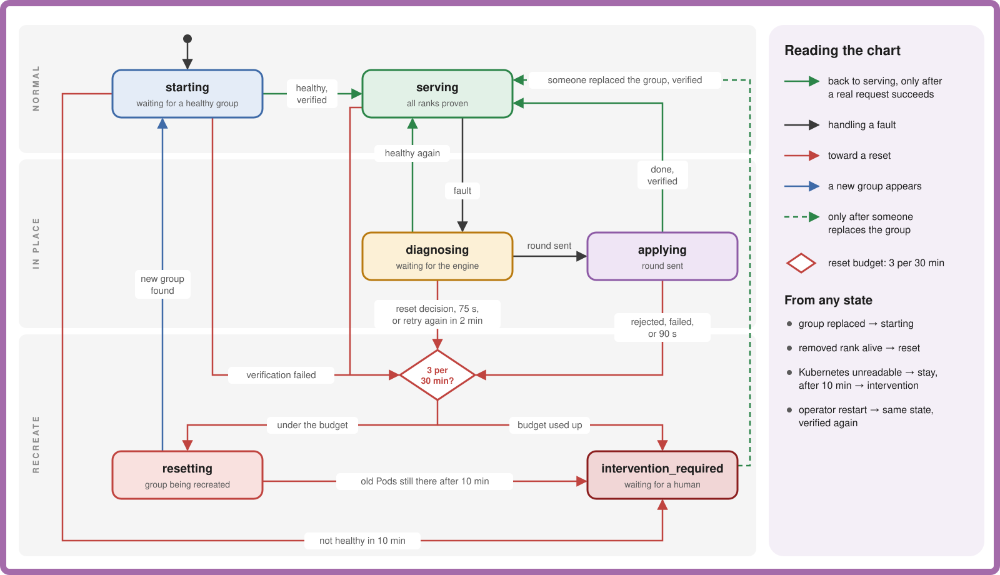
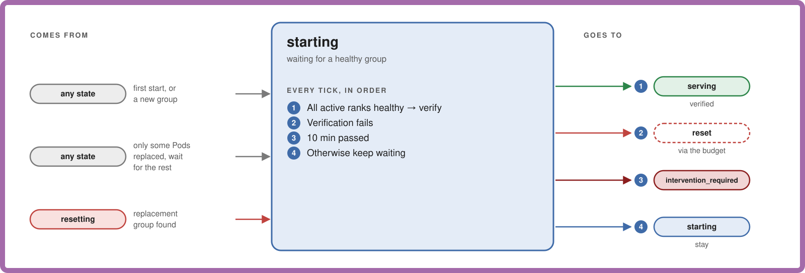
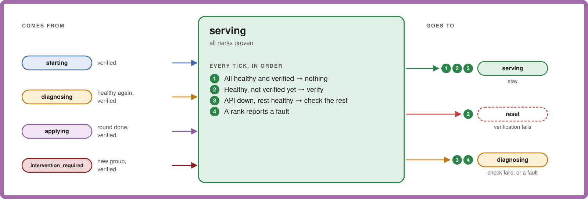
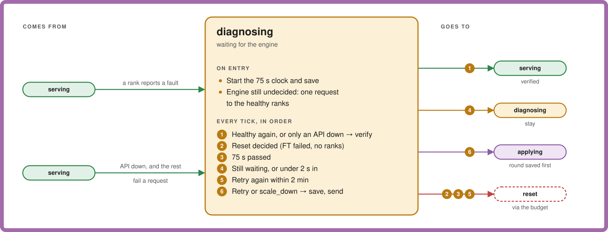
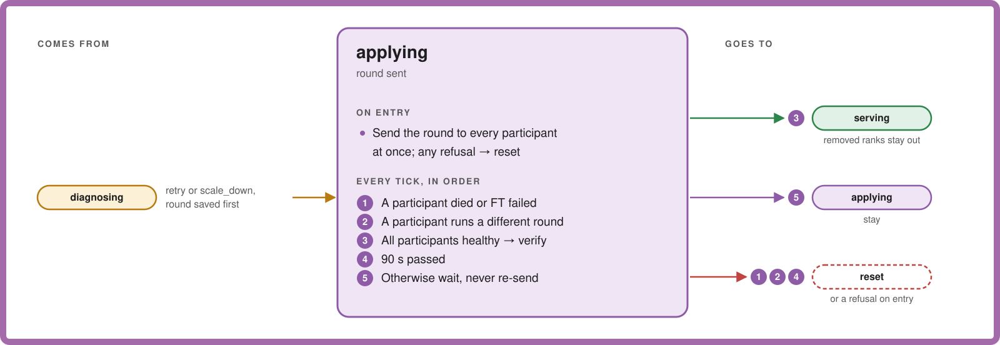
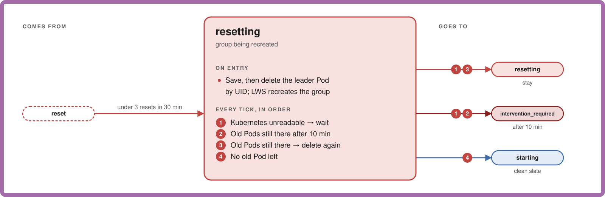
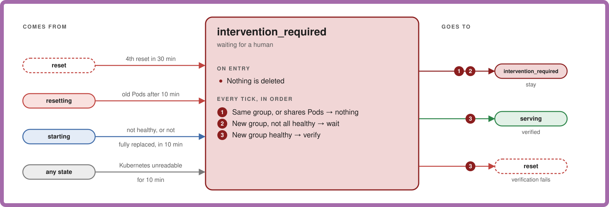

# Engine Fault State Machine

- **Revision**: 1
- **Last Updated**: 2026-10-11

---

Every state the recovery controller can be in. Read the overview top to bottom:
the further down, the more drastic the action. Each state is then expanded on
its own. The why is in the [design overview](engine-fault-recovery.md), and
what picks the next step in `serving` and `diagnosing` is in
[decisions](engine-fault-decisions.md).

## Overview

Three rules hold everywhere:

- `serving` is reached only after a real request succeeds.
- Every reset goes through the budget: 3 in 30 minutes, then
  `intervention_required`.
- Deadlines are saved in the [journal](journal-and-failover.md), so an operator
  restart doesn't extend them.

---

## States

Each card shows where the state comes from, what IRO does on entry and on every
tick (checked in order), and where each check leads.

### starting

The group isn't proven yet.

After a reset, the 10 minutes count from the reset itself, so they include Pod
restart and model load.

### serving

Where the group spends almost all its time. Healthy ticks change nothing and
write nothing.

An API that stops answering, with nothing else wrong, doesn't change
membership as long as the healthy ranks still answer.

### diagnosing

Something is wrong and IRO waits for the engine to say what.

The request on entry is there because an idle rank may only notice a dead peer
once it has work to do.

### applying

A recovery round is in flight.

After a restart, the new leader checks the saved round against the round IDs
the ranks report, and never sends it again.

### resetting

The group is being recreated.

The repeated delete always names the old leader's UID, so it can't hit the new
leader. The reset count carries over to the new group.

### intervention_required

IRO has stopped acting on this group and waits for someone to replace it.

How to get a group out of here is in [operations](../operations.md).

---

## Timers

| Timer | Default | Flag | Bounds |
| --- | --- | --- | --- |
| Tick | 1 s | none | Loop interval. First action at least 2 s into `diagnosing`. |
| Diagnosis | 75 s | `--vllm-diagnosis-timeout` | Time in `diagnosing`. |
| Apply | 90 s | `--vllm-apply-timeout` | Time in `applying`. |
| Startup | 10 min | none | `starting`, `resetting`, partial replacement, Kubernetes outage. |
| Retry window | 2 min | none | A second `retry` inside it resets instead. |
| Reset budget | 3 per 30 min | none | Then `intervention_required`. |

---

## Examples

H = healthy, U = unhealthy.

### One rank crashes

| When | Ranks 0 1 2 3 | State |
| --- | --- | --- |
| t | U U U dead | `serving` → `diagnosing` |
| t + 2 s | U U U dead | `applying`, scale_down removes 3 |
| later | H H H dead | `serving`, rank 3 out |

### A stall that clears

| When | Ranks 0 1 2 3 | State |
| --- | --- | --- |
| t | U U U U | `serving` → `diagnosing` |
| t + 2 s | U U U U | `applying`, retry all |
| later | H H H H | `serving` |
| again within 2 min | U U U U | `diagnosing`, then reset |

### A rank that never makes up its mind

| When | Ranks 0 1 2 3 | State |
| --- | --- | --- |
| t | H H diagnosing H | `serving` → `diagnosing`, one probe request |
| t + 75 s | H H diagnosing H | reset → `resetting` |
| later | new group | `starting` → `serving` |
| 4th time in 30 min | | `intervention_required` |
