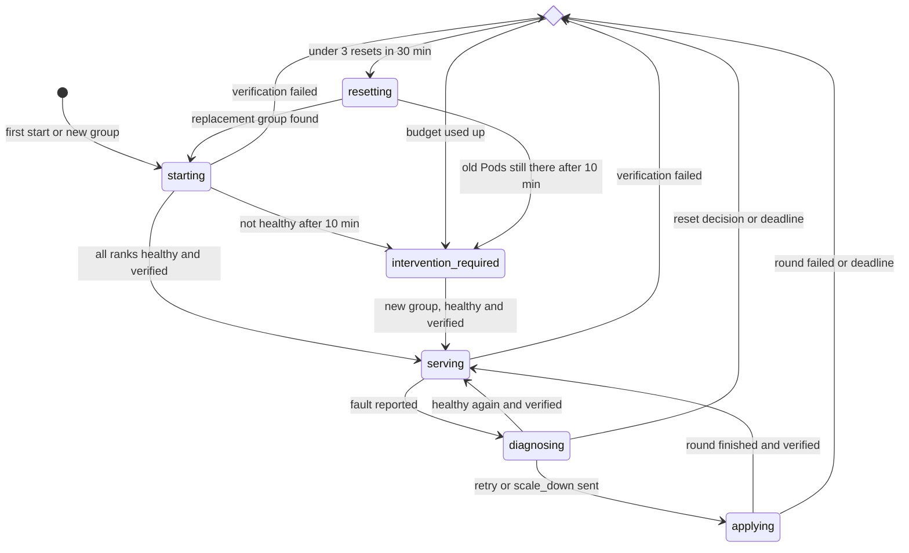
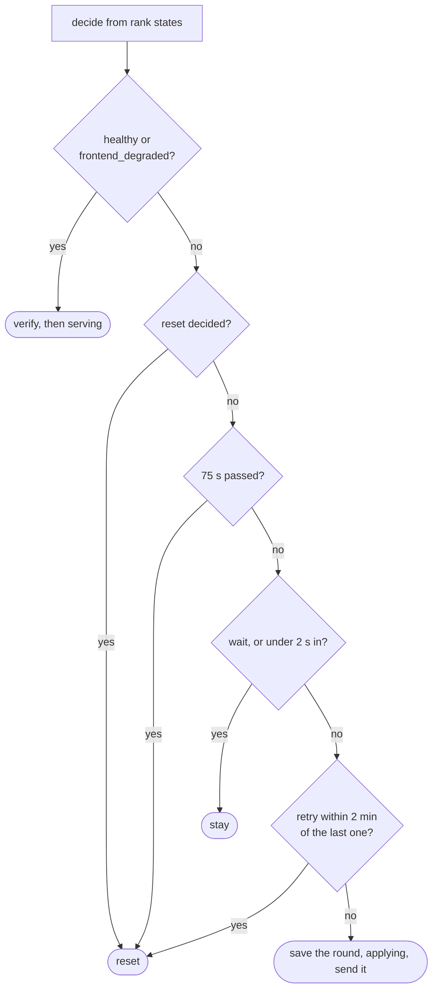
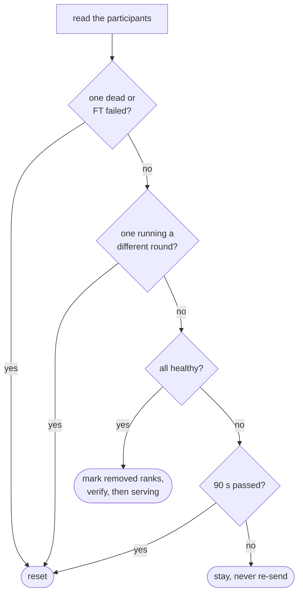
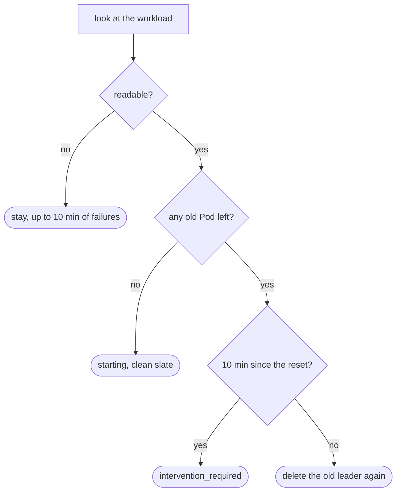
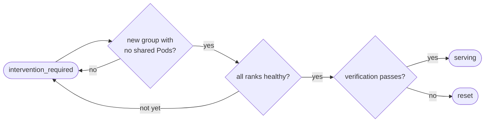

# Engine Fault State Machine

- **Revision**: 1
- **Last Updated**: 2026-10-11
- **PR**: [#11](https://github.com/llm-d-incubation/llm-d-resiliency-operator/pull/11)

---

Every state the recovery controller can be in, how it gets there and how it
leaves. The why is in the [design overview](engine-fault-recovery.md). What
picks the next step in `serving` and `diagnosing` is in
[decisions](engine-fault-decisions.md).

## State Machine

The diamond is the reset budget: at most 3 resets in any 30 minutes.

### From any state

| What happens | Result |
| --- | --- |
| Kubernetes can't be read | Same state, same deadlines, no action. |
| ...for 10 minutes | `intervention_required` |
| The group is replaced (new Pods or containers) | `starting` |
| The group is only partly replaced | `starting`, waits up to 10 minutes for the rest |
| A removed rank reports alive | reset |
| The operator restarts or a new leader takes over | Same state, restored from the [journal](journal-and-failover.md). Verification is redone. |

---

## States

### starting

The group isn't proven yet: first start, a group IRO hasn't seen before, or the
replacement after a reset. Each tick IRO reads every rank. Once all active
ranks are healthy, it sends each one a real request (verification).

| Way out | Next |
| --- | --- |
| All active ranks healthy, verification passes | `serving` |
| Verification fails | reset |
| Still not healthy after 10 minutes | `intervention_required` |

After a reset, the 10 minutes count from the reset itself, so they include Pod
restart and model load.

### serving

Every active rank is healthy and IRO has seen each one answer a request. The
group spends almost all its time here. Healthy ticks change nothing and write
nothing.

| Way out | Next |
| --- | --- |
| A rank reports a fault | `diagnosing` |
| An API stops answering and the healthy ranks fail a request | `diagnosing` |
| Re-verification fails, for example right after an operator restart | reset |

An API that stops answering, with nothing else wrong, doesn't leave `serving`
as long as the healthy ranks still answer. Membership doesn't change.

### diagnosing

Something is wrong and IRO waits for the engine to say what. The first tick
only starts a 75 s clock and saves. If the engine hasn't classified the fault
yet, IRO also sends one request to the healthy ranks, because an idle rank may
only notice a dead peer once it has work.

Every later tick:

| Way out | Next |
| --- | --- |
| Healthy again, verification passes | `serving` |
| `retry` or `scale_down` decided, at least 2 s in | `applying` |
| Reset decided (FT failed, no ranks left) | reset |
| 75 s without a usable answer | reset |
| A second `retry` within 2 minutes of the last one | reset |

### applying

A recovery round was saved, then sent to the participating ranks. IRO waits for
it to finish. It never sends the same round twice, even after a restart.

| Way out | Next |
| --- | --- |
| Every participant healthy, verification passes | `serving`, removed ranks stay out |
| A participant didn't accept the round | reset |
| A participant died or reported FT failed | reset |
| A participant is running a different round | reset |
| Not finished after 90 s | reset |

### resetting

IRO deleted the group's leader Pod and waits for the workload to come back as a
completely new group. The workload controller recreates every Pod in the group
when the leader goes.

| Way out | Next |
| --- | --- |
| No Pod from the old group is left | `starting`, removed ranks and rounds cleared |
| Old Pods still there after 10 minutes | `intervention_required` |

The repeated delete always names the old leader's UID, so it can never hit the
new leader. The reset count carries over to the new group.

### intervention_required

IRO has stopped acting on this group and waits for someone to replace it.
Nothing is deleted on the way in. It gets here when:

- a 4th reset was needed within 30 minutes,
- old Pods didn't go away after a reset,
- a partial replacement didn't finish,
- the group didn't get healthy in 10 minutes, or
- Kubernetes couldn't be read for 10 minutes.

How to get a group out of here is in [operations](../operations.md).

---

## Timers

| Timer | Default | Flag | Bounds |
| --- | --- | --- | --- |
| Tick | 1 s | none | Loop interval. First action at least 2 s into `diagnosing`. |
| Diagnosis | 75 s | `--vllm-diagnosis-timeout` | Time in `diagnosing`. |
| Apply | 90 s | `--vllm-apply-timeout` | Time in `applying`. |
| Startup | 10 min | none | `starting`, `resetting`, partial replacement, Kubernetes outage. |
| Retry window | 2 min | none | A second `retry` inside it resets instead. |
| Reset budget | 3 per 30 min | none | Then `intervention_required`. |

Deadlines are timestamps in the journal, so a restart doesn't extend them.

---

## Examples

H = healthy, U = unhealthy.

### One rank crashes

| When | Ranks 0 1 2 3 | State |
| --- | --- | --- |
| t | U U U dead | `serving` → `diagnosing` |
| t + 2 s | U U U dead | `applying`, scale_down removes 3 |
| later | H H H dead | `serving`, rank 3 out |

### A stall that clears

| When | Ranks 0 1 2 3 | State |
| --- | --- | --- |
| t | U U U U | `serving` → `diagnosing` |
| t + 2 s | U U U U | `applying`, retry all |
| later | H H H H | `serving` |
| again within 2 min | U U U U | `diagnosing`, then reset |

### A rank that never makes up its mind

| When | Ranks 0 1 2 3 | State |
| --- | --- | --- |
| t | H H diagnosing H | `serving` → `diagnosing`, one probe request |
| t + 75 s | H H diagnosing H | reset → `resetting` |
| later | new group | `starting` → `serving` |
| 4th time in 30 min | | `intervention_required` |

---

## Known Gaps

- A model that takes over 10 minutes to load ends in `intervention_required`,
  and that same group never leaves it, even once healthy.
- `intervention_required` raises no Event or metric, and doesn't try again
  once the reset budget refills.
- A failed journal write still changes the in-memory state, and `resetting`
  can repeat the delete without a saved write.
- Removed ranks only come back with a new group.
