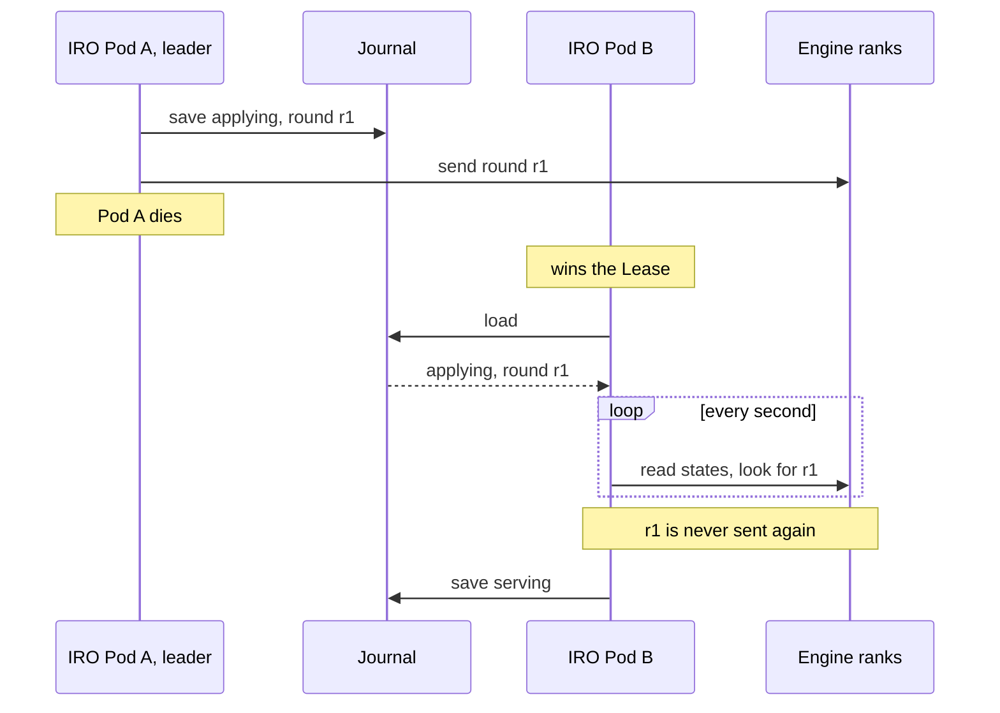
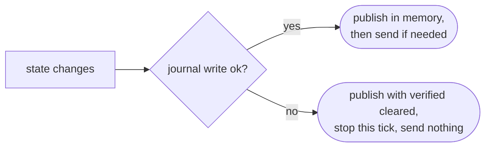

# Journal and Failover Design

- **Revision**: 1
- **Last Updated**: 2026-10-11

---

## Problem

The recovery controller keeps its state in memory, and the operator Pod can die
at any moment, often in the middle of a recovery. The next leader has to know
what was going on, must not send a round twice, and must keep the original
deadlines. And only one replica may act at a time.

---

## Design Overview



Three pieces:

1. **Journal.** The controller state, as JSON in a ConfigMap next to the
   workload.
2. **Save before send.** Every round is written before it goes out.
3. **One leader.** A Lease decides which replica runs the loop.

---

## Mechanism 1: The Journal

ConfigMap `<lws>-ft-state` in the workload's namespace, key `state.json`. It is
read once, when a replica becomes leader, and written when something changes.
Healthy ticks don't write.

| Field | Holds |
| --- | --- |
| `phase` | the current [state](engine-fault-state-machine.md) |
| `group`, `previous_group` | the current group, and the one being replaced |
| `excluded` | removed ranks |
| `verified` | ranks proven by the last check (a record, not a gate) |
| `status` | the last rank states |
| `round`, `instruction`, `acceptances` | the last round, its action, who accepted it |
| `since` | when the current state began |
| `discovery_unavailable_since` | when Kubernetes reads started failing |
| `last_retry` | when the last `retry` was sent |
| `resets` | recent reset times, for the budget |
| `reason` | why the last change happened |

Trimmed example while a round is in flight:

```json
{
  "phase": "applying",
  "round": {
    "id": "iro-ft-5b1e0c27",
    "group_id": "4e1fa2c9",
    "participants": [0, 1, 2],
    "removed": [3]
  },
  "instruction": "scale_down",
  "since": "2026-10-11T09:14:09Z",
  "reason": "native terminal dead ranks cannot resume serving"
}
```

Writes carry the ConfigMap's `resourceVersion`, so an older writer can't
overwrite a newer one.

---

## Mechanism 2: Save Before Send



- A round goes out only after it has been saved.
- After a restart in `applying`, the new leader reads rank states and request
  IDs to see how the round went. It never sends the round again.
- `verified` is cleared on load, so the new leader proves the group again.
- Deadlines are timestamps in the journal, so a failover doesn't extend them.

---

## Mechanism 3: One Leader

- The manager's Lease `llm-d-resiliency-operator-leader`, in the operator's
  namespace. Timings are the controller-runtime defaults: 15 s lease, 10 s
  renew deadline, 2 s retry.
- Engine fault recovery refuses to start without `--leader-elect`.
- A replica that loses the Lease exits, and Kubernetes restarts it as a
  candidate.
- During a rollout the old and new Pods overlap, but only the Lease holder
  acts. The new leader can wait up to 15 s after the old one exits.

---

## Risks and Mitigations

| Risk | Mitigation |
| --- | --- |
| Leader dies after sending a round | The new leader reconciles it from rank states and request IDs. |
| Leader dies between saving and sending | The round never arrives, nothing progresses, and after 90 s the group is reset. Slower, but never doubled. |
| Two replicas act at once during a handover | Lease timings, plus `resourceVersion` on journal writes. Gap: a failed write still updates memory, and `resetting` can repeat the delete without a saved write. |
| Journal write keeps failing | Nothing is sent and `verified` stays empty. Gap: there's no reload after a conflict, so it fails until the leader restarts. |
| Journal deleted while ranks are removed | The removed ranks look active again, the group can't pass `starting`, and it ends in `intervention_required` after 10 minutes. Keep the journal. |
| Several IRO instances in one namespace | They share one Lease name, so only one runs. Gap; see follow-ups. |

---

## Follow-ups

- Don't publish state in memory when the write fails, and reload after a
  conflict.
- Save before repeating a delete in `resetting`.
- Name the Lease after the group and put it in the workload's namespace, so
  each group gets exactly one coordinator wherever IRO runs.
