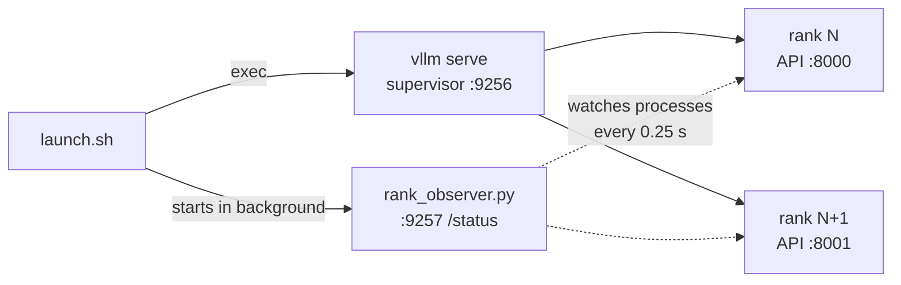
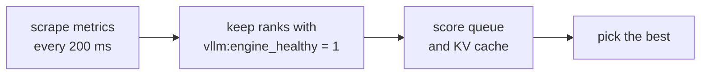

# vLLM Engine

The vLLM adapter (`internal/engine/vllm`) implements the
[engine contract](../design/adapters.md) over HTTP. This page covers what vLLM
has to provide and how each call maps onto it.

## Requirements

- vLLM with the FT API, one API port per data-parallel (DP) rank
  (multi-port external load balancing), and native per-rank health. These are
  still open upstream; see [References](#references).
- TP=1 with expert parallelism. Each rank keeps its original DP rank ID.
- A supervisor that keeps survivors running during diagnosis and FT, and never
  restarts a removed rank in the same group.
- `/v1/completions` requests without a `model` field go to the base model.
- The runtime bridge in every Pod: `launch.sh` and `rank_observer.py`
  ([runtime/vllm](../../runtime/vllm/README.md)).

---

## Inside a Pod



Each rank runs three processes: an API server, an EngineCore and a worker. The
observer remembers the first PID and start time of each, so it can tell a
process that died or was replaced.

---

## Calls

| Contract call | Request | IRO checks |
| --- | --- | --- |
| `EngineStatus` | `GET <rank>/v1/fault_tolerance/status` | `schema_version` 1, one engine, its `id` equals the rank, status is one of the four |
| | `GET <pod>:9257/status` (observer) | same Pod UID; `engine_dead` for the rank becomes exit evidence |
| `ResumeEngine` | `POST <rank>/v1/fault_tolerance/apply`, `retry` | HTTP 202 from every participant |
| `ScaleDown` | same, `scale_down` with `removed_dp_ranks` | HTTP 202 from every participant |
| `Verify` | `POST <rank>/v1/completions` | a choice with text, and `completion_tokens` > 0 |

Status response:

```json
{
  "schema_version": 1,
  "engines": [
    {"id": 3, "status": "dead", "fault_info": "...", "ft_state": "", "ft_error": "", "last_ft_request_id": ""}
  ]
}
```

Round request. `dp_master_ip` and `dp_store_port` are only sent when the lowest
active rank is removed; the store moves to the first survivor's host.

```json
{
  "instruction": "scale_down",
  "request_id": "iro-ft-5b1e0c27",
  "params": {"removed_dp_ranks": [0], "dp_master_ip": "10.0.0.10", "dp_store_port": 29600}
}
```

Verification request:

```json
{"prompt": "One plus one equals", "max_tokens": 8, "temperature": 0}
```

vLLM's four statuses map one to one onto the native states. An unreadable
endpoint, an unexpected schema, a rank ID mismatch or an unknown status becomes
`unknown`.

---

## Observer

| Situation | `engine_dead` |
| --- | --- |
| Processes not started yet | no (the rank is still listed) |
| Only the API server exited | no |
| EngineCore or worker exited, turned zombie, or was replaced | yes |
| Process can't be read | no |

The observer always lists every configured rank, even after one is removed.
IRO uses that list to learn the rank layout.

---

## launch.sh

| Environment variable | Becomes |
| --- | --- |
| `POD_UID` | the Pod the observer's evidence belongs to |
| `IRO_RANK_START` | `--data-parallel-start-rank`, observer `--start-rank` |
| `IRO_LOCAL_RANKS` | `--data-parallel-size-local`, observer `--local-ranks` |
| `IRO_DP_SIZE` | `--data-parallel-size` |
| `IRO_DP_ADDRESS` | `--data-parallel-address` |
| `IRO_OBSERVER_PORT` (9257) | observer `--port` |
| `IRO_SUPERVISOR_PORT` (9256) | `--data-parallel-supervisor-port` |
| always | `--data-parallel-multi-port-external-lb --tensor-parallel-size 1 --enable-expert-parallel --enable-fault-tolerance` |

---

## Routing



In [epp-config.yaml](../../runtime/vllm/epp-config.yaml) a missing metric fails
closed and an empty candidate set isn't widened. The InferencePool has to list
every rank port, and EPP needs its experimental plugins enabled. The
supervisor's `/health` and `/ready` are Pod probes, not a per-rank signal.

---

## References

- [runtime/vllm/README.md](../../runtime/vllm/README.md) and
  [deploy/vllm-ft/README.md](../../deploy/vllm-ft/README.md)
- vLLM [#46370](https://github.com/vllm-project/vllm/pull/46370): fault-tolerant
  EP with scale-down (open)
- vLLM [#54963](https://github.com/vllm-project/vllm/pull/54963): keep the
  multi-port DP supervisor serving through FT (open)
- vLLM [#55915](https://github.com/vllm-project/vllm/pull/55915): per-rank FT
  health (open)
