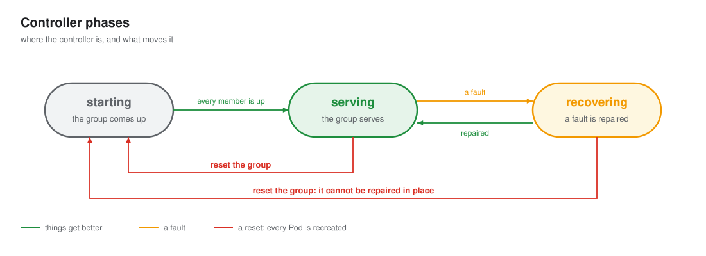

# Failures

Every failure IRO handles, one page each. Each page shows the failure step by step: the group's Pods and
members, the controller's phase, and every call IRO makes with its input and output.

## How IRO recovers

1. **Remove in place.** When the engine proves members are gone, one reconfig removes them. The rest keep serving.
2. **Restore capacity.** Once the group serves, IRO resets the failed Pods once and admits their new members.
3. **Reset as the last resort.** When nothing can be removed safely, or a recovery itself fails, IRO resets the
   whole group. It never gives up on its own: the workload's restart policy paces resets.
4. **Never act blind.** IRO never removes a member it cannot see, and never resets a group it cannot list.

A fault always comes first: capacity work waits until the group serves again.

### Engine members

| Failure | IRO sees | Ends with |
|---|---|---|
| [A member dies](member-dies.md) | the engine reports the member terminal; the others pause | full again, without a restart |
| [Several members die at once](several-members-die.md) | several members terminal at once | full again, without a restart |
| [Another member dies after a shrink](another-member-dies.md) | a new terminal member while others are already excluded | serving with fewer members, then full again as the Pods are reset |
| [A transient fault](transient-fault.md) | every member paused, none terminal | the same members, serving |
| [A member hangs](member-hangs.md) | paused members, none terminal; the policy says `Wait` | a new group |
| [A member cannot be read](member-unreadable.md) | an unknown member next to readable ones | a new group |

### Pods

| Failure | IRO sees | Ends with |
|---|---|---|
| [A Pod is lost](pod-lost.md) | `Discover` no longer lists the Pod; its members are added as terminal, `pod lost` | full again, or a new group if the workload recreates the whole group |
| [The failed Pod cannot come back](capacity-not-restored.md) | `Reset` is unsupported, or the new member cannot join | serving below full until the next group, or a reset with `--ft-capacity-restore=reset-all` |

### Recovery itself

| Failure | IRO sees | Ends with |
|---|---|---|
| [A reconfig fails](reconfig-fails.md) | `Progress` says `Failed` with scope `Group` | a new group |
| [A reconfig never finishes](reconfig-hangs.md) | `Progress` says `Running` past `--ft-apply-timeout` | a new group |
| [The group cannot generate after a recovery](verify-fails.md) | `Verify` keeps failing after a reconfig | a new group |
| [The engine cannot recover in place](unrecoverable.md) | the policy says `Unrecoverable` | a new group |

### IRO itself

| Failure | IRO sees | Ends with |
|---|---|---|
| [The IRO leader dies mid-reconfig](leader-dies.md) | a reconfig in the journal, with or without saved acceptances | the recovery finishes, never sent twice |
| [IRO cannot see the group](iro-blind.md) | `Observe` reads no admitted member | nothing, if reads come back in time; otherwise a new group |
| [The journal is lost](journal-lost.md) | an empty journal | the same group, never reset |

The workload can also give up recreating the group (`RecreateStopped`). IRO then waits and acts on
nothing until the workload recreates the group; see [considerations](../components/controller.md#design-notes).
