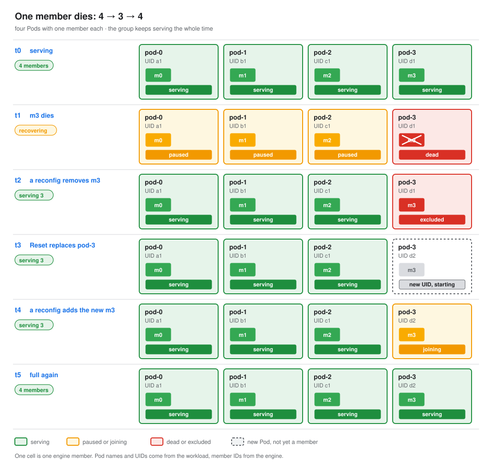
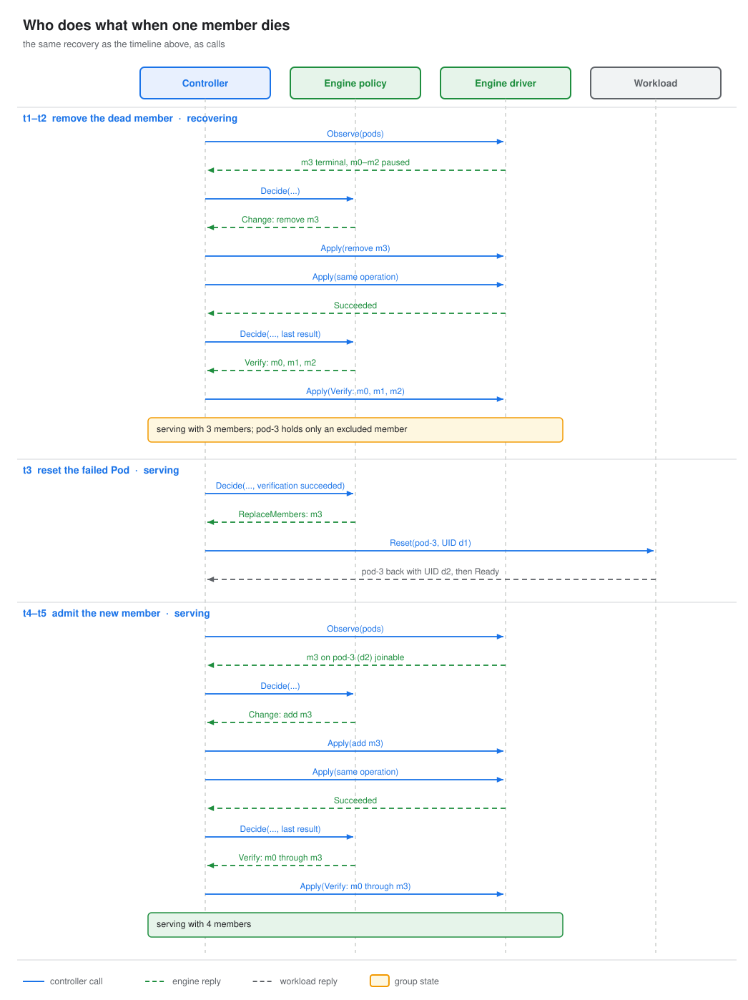

# A member dies

One member's process exits. The rest keep serving, and the group is full again once the failed Pod is reset.

- **IRO sees:** the engine reports the member terminal; the others pause
- **IRO does:** removes it in one reconfig, verifies the survivors, then resets its Pod and admits the new member
- **Ends with:** full again, without a restart
- **Rules:** [C1](../components/controller.md#checks-on-every-plan), [C8](../components/controller.md#checks-on-every-plan), [restoring capacity](../components/controller.md#restoring-capacity)

[example member-dies]: ../scenarios/member-dies.json

## How it works

1. **Remove the dead member.** The driver reports `m3` Terminal. The policy proposes `Remove`, the reconfig
   runs, and `Progress` reports `Succeeded`. Only then does the controller record `m3@idD` as excluded and
   verify the survivors.
2. **Reset the failed Pod.** Each member names its Pod, so the controller knows `pod-3` now holds only
   excluded members. It calls `Reset` on it. The rest of the group keeps serving. There is no deadline;
   scheduling and model loading take as long as they take.
3. **Admit the new member.** The new Pod's members show up as candidates. The policy plans `Add` when the
   engine can admit them, the reconfig runs like any other, and the reconfig's members are verified.

A fault at any point comes first: the group goes to `recovering`, and the capacity work continues once the
group serves again.

Capacity never comes from new Pods elsewhere: it comes back by resetting, with one try. If resetting the
Pod fails in any way (the workload answers `ErrUnsupported`, the engine cannot admit members, or the new Pod
fails to join), the group keeps serving with fewer members until the next group. With
`--ft-capacity-restore=reset-all`, IRO resets the whole group instead and never stays below full. With
`release`, it frees the failed Pod's GPUs and serves below full.
