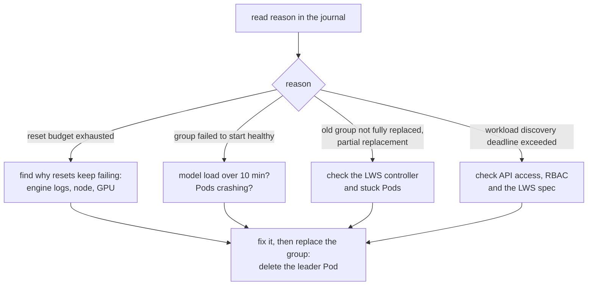

# Operations

How to see what engine fault recovery is doing, and what to do about it.

## Where to Look

There are no Events or metrics yet. The journal is the source of truth.

```bash
# current state, why, and which ranks are out
kubectl -n <lws-namespace> get cm <lws>-ft-state -o jsonpath='{.data.state\.json}' \
  | jq '{phase, reason, excluded, verified, since, resets}'

# errors from the loop
kubectl -n <operator-namespace> logs deploy/llm-d-resiliency-operator | grep 'reconcile engine fault'

# who is leader
kubectl -n <operator-namespace> get lease llm-d-resiliency-operator-leader
```

---

## What Each State Means for You

| State | Meaning | Do |
| --- | --- | --- |
| `starting` | Waiting for a new group to come up healthy. | Nothing. Check the Pods if it lasts many minutes. |
| `serving` | All active ranks proven. | Check `excluded`; the group may be running with fewer ranks. |
| `diagnosing` | Fault seen, waiting for the engine, 75 s at most. | Nothing. |
| `applying` | Recovery round sent, 90 s at most. | Nothing. |
| `resetting` | Leader Pod deleted, group being recreated. | Watch the Pods come back. |
| `intervention_required` | IRO stopped acting on this group. | See [below](#stuck-in-intervention_required). |

Full detail: [state machine](design/engine-fault-state-machine.md).

---

## Reasons You'll See

The journal's `reason` field says why the last change happened.

| Reason starts with | Meaning | State |
| --- | --- | --- |
| `inference verified` | The group passed its check. | `serving` |
| `new group discovered`, `replacement group discovered` | A group IRO hasn't seen. | `starting` |
| `waiting for complete LWS group replacement` | Only some Pods were replaced. | `starting` |
| `waiting for native terminal death…`, `survivors are not all unhealthy yet` | Waiting for the engine to classify the fault. | `diagnosing` |
| `waiting for engine diagnosis after a bounded inference probe` | Same, after poking idle ranks once. | `diagnosing` |
| `all participants faulted and no dead rank` | Retry round. | `applying` |
| `native terminal dead ranks cannot resume serving` | Scale-down round. | `applying` |
| `diagnosis deadline exceeded` | 75 s without a usable answer. | `resetting` |
| `retry failed sustained serving within the stability window` | Second retry within 2 minutes. | `resetting` |
| `FT dispatch failed` | A rank didn't accept the round. | `resetting` |
| `rank N FT failed`, `conflicting engine FT operation`, `FT completion deadline exceeded` | The round didn't finish. | `resetting` |
| `vLLM reports failed FT`, `no active ranks`, `no surviving ranks` | Nothing left to recover in place. | `resetting` |
| `inference verification failed`, `engine health changed during verification` | The check after recovery failed. | `resetting` |
| `excluded rank N is no longer terminal` | A removed rank came back to life. | `resetting` |
| `reset budget exhausted` | A 4th reset within 30 minutes. | `intervention_required` |
| `group failed to start healthy` | Not healthy within 10 minutes. | `intervention_required` |
| `old group not fully replaced`, `partial LWS replacement did not complete` | Old Pods didn't go away. | `intervention_required` |
| `workload discovery unavailable` | Kubernetes reads are failing. | unchanged |
| `workload discovery deadline exceeded` | They failed for 10 minutes. | `intervention_required` |

---

## Common Situations

### Running with removed ranks

After a `scale_down`, `excluded` lists the removed ranks and the group serves
with the rest. Nothing brings them back. To get full capacity, recreate the
group when it suits you:

```bash
kubectl -n <lws-namespace> delete pod <lws>-0
```

LWS recreates every Pod, and IRO picks up the new group, checks it and clears
`excluded`.

### Stuck in intervention_required



IRO leaves this state only for a new group with no Pods in common with the old
one. Once that group is healthy and passes its check, it's back to `serving`.

### A reset every few minutes

Look at `reason` and `resets`. Repeated `diagnosis deadline exceeded` usually
means a rank hangs without dying. Repeated `FT dispatch failed` means the
engine rejects the round, often because the survivors can't hold the model.
After 3 resets in 30 minutes IRO stops by itself.

### Kubernetes reads failing

`workload discovery unavailable: …` gives the error. Common causes: missing RBAC
(see [LWS workload](workloads/lws.md#rbac)), an LWS that doesn't meet the
[requirements](workloads/lws.md#requirements), Pods still starting, or an
unreachable observer on the first discovery.

### Slow model start

The startup limit is 10 minutes and has no flag yet. It also covers the time
after a reset. A model that loads slower ends in `intervention_required` and
stays there even once healthy. Replace the group by hand after it's up.

---

## Upgrades and Restarts

- Restarting or upgrading the operator is safe at any time. The new leader
  carries on from the journal and never re-sends a round.
- Expect up to about 15 s without a coordinator while the Lease moves.
- Don't delete the journal, especially while ranks are removed.

## Turning It Off

Remove `--enable-engine-ft`. The group keeps running as it is, with removed ranks
still out, and the journal stays. Turning it back on resumes from the journal.
