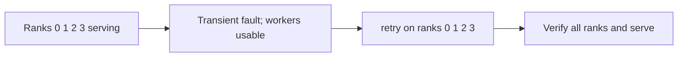
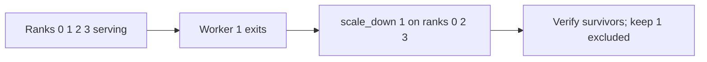
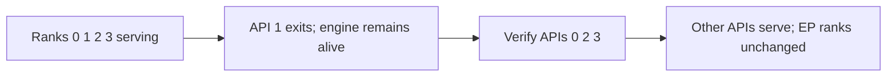
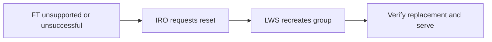

# vLLM EngineAdapter for IRO
## Summary
Add an opt-in vLLM EngineAdapter to IRO. Handle engine faults while Pods and containers remain alive: retry usable ranks or exclude failed ranks and continue serving through survivors. If FT cannot restore serving, request normal LWS group recreation.

## Motivation
llm-d wide EP uses LWS, where Pod/container failure can recreate the group. Engine-level FT preserves usable processes and model state before that boundary.

Goals: coordinate supported vLLM actions, protect serving during FT, verify inference, and hand unsuccessful attempts to LWS. Non-goals: failed-process repair or rejoin, capacity restoration, request replay, infrastructure repair, and changes to RecoveryRequest or LWS restart policy.

## Proposal
Run inside IRO’s controller-runtime manager with `--enable-vllm-ft` and `--leader-elect`. Only the elected leader coordinates faults and exposes ready admission endpoints. Existing RecoveryRequest handling remains unchanged.

| Component | Responsibility and interface |
| --- | --- |
| [Engine contract](../../internal/engine) | EngineStatus, FaultEvents, ResumeEngine, ScaleDown and Verify. Rounds identify the group and original ranks. |
| [vLLM adapter](../../internal/engine/vllm) | Per-rank HTTP status, commands and inference verification. Confirmed EngineCore/worker exits override stale health; API-only loss is separate. |
| [Fault coordinator](../../internal/controller/enginefault) | Select actions, close admission, persist rounds, reconcile completion and request reset. Runner shares IRO leadership and shutdown. |
| [LWS integration](../../internal/workload/lws) | Discover Pods through IRO’s Kubernetes clients; fence Pod/container identities. Persist `<name>-ft-state` with version checks; reset through UID-fenced leader deletion. |
| [Runtime bridge](../../runtime/vllm) | Launcher, Pod-scoped process observer and admission middleware. The compatible supervisor preserves diagnosing/unhealthy local engines during FT. |
| [llm-d routing](../../runtime/vllm/epp-config.yaml) | EPP filters `vllm:engine_healthy` and `iro_rank_admitted` per port. Middleware checks /admission by rank/Pod UID and fails closed; authenticated verification probes bypass it. |

Start with one ordinal LWS group, replicas=1, uniform local DP ranks and TP=1: Pod A hosts 0/1; B hosts 2/3. The `deploy/vllm-ft` overlay wires IRO access/admission. Supply a compatible vLLM runtime, expert redundancy and a validated minimum survivor count.

Track D and ResumeEngine map to retry; Track C’s ScaleDown maps to explicit exclusion. FaultEvents exposes engine faults. PauseEngine and ScaleUp return unsupported; infrastructure repair tracks remain unchanged.

## Design Details
The adapter calls each rank’s API directly: GET /v1/fault_tolerance/status and POST /v1/fault_tolerance/apply. One shared, non-empty request_id identifies a round across participants. HTTP 202 confirms acceptance; poll subsequent status/errors and verify inference before reopening admission.

Persist the round before dispatch. After an IRO restart, reconcile it instead of blindly replaying commands. Preserve original DP coordinates after exclusion. Metrics guide routing; health 0 or a missing API alone does not prove a dead rank.

### Retry usable ranks

Example: rank 1 raises a transient execution exception; peers encounter collective timeouts. Workers remain usable. Close admission, wait for eligible vLLM diagnosis, then send this request concurrently to ranks 0/1/2/3:
```json
{"instruction":"retry","request_id":"iro-ft-101","params":{}}
```
vLLM resets execution/communication state. Reopen admission after healthy status and verified inference; observe later execution and EPLB activity for recurrence.

### Exclude an unusable rank

Example: worker 1 exits inside Pod A. Confirm the exit and eligible survivor states, check capacity, and close admission. If idle peers need to enter diagnosis, issue an internal inference probe. Send this request to ranks 0/2/3:
```json
{"instruction":"scale_down","request_id":"iro-ft-102",
 "params":{"removed_dp_ranks":[1]}}
```
vLLM redistributes experts and reconfigures collectives. Placement becomes fixed and ongoing EPLB is suppressed. Verify ranks 0/2/3 before admission; preserve their coordinates. Rank 1 stays excluded even if its API reports healthy or becomes reachable again.

### Lose only an API frontend

Example: API 1 exits while EngineCore 1 and worker 1 remain alive. Verify inference through APIs 0/2/3 and admit them without an FT command or EP membership change. Failed verification starts bounded diagnosis; it does not justify guessing a rank to exclude.

### Scenario outcomes

| Scenario | Action and outcome |
| --- | --- |
| Worker or EngineCore exits | Exclude its DP rank; verified survivors serve. Use process evidence even if its API also exits. |
| Rank stalls during execution | Exclude only after consistent survivor diagnosis identifies it; otherwise reset after the deadline. |
| Fault occurs while idle | Diagnose using process evidence and an internal probe, then retry, exclude or reset. |
| Store-master rank 0 fails | Exclude [0] on ranks 1/2/3 with replacement dp_master_ip and dp_store_port; verify survivors or reset. |
| Multiple or repeated failures | Exclude newly failed original ranks in a new round, preserving prior exclusions. Backend validation is pending; unsupported combinations reset. |
| FT unsupported or unsuccessful | Too few survivors, command rejection/partial acceptance, failed verification or unresolved diagnosis: close admission and reset. |
| Pod or container lifecycle failure | Pod deletion, container restart or every local API exiting abandons the round and recreates the group. Readiness loss alone does not. |
| Node or replacement startup failure | Follow actual Pod lifecycle; unresolved faults take the bounded reset path. Report deployment failure until serving is verified. |

### Reset fallback

Example: ranks 1/2/3 fail below the configured minimum. Request reset without scale_down. LWS recreates the group under RecreateGroupOnPodRestart; rediscover identities and verify inference before admission. Inference can be unavailable during FT/reset.

### Validation and enablement
Prototype GPU tests passed retry, worker exclusion, API-only loss, store-master exclusion and capacity reset. EngineCore/stall results remain qualified by an output difference/gateway error. Multiple-rank backend work is deferred. This manager integration passes local tests but needs GPU validation. Complete lifecycle/idle cases; wider TP, multiple groups and node failures remain unvalidated.

## Alternatives
Always reset LWS: simpler, but discards usable ranks and model state. Rank repair, ScaleUp and LWS policy changes require a separate lifecycle proposal.

### References
IRO public design — EngineAdapter and fault-handling tracks.
[vLLM FT API and implementation](https://github.com/vllm-project/vllm/pull/46370)
[vLLM surviving local rank processes](https://github.com/vllm-project/vllm/pull/54963)
[vLLM native rank health metric](https://github.com/vllm-project/vllm/pull/55915)
[llm-d wide EP with LWS](https://github.com/llm-d/llm-d/tree/main/guides/wide-ep-lws)
