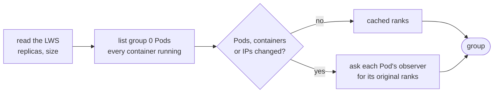
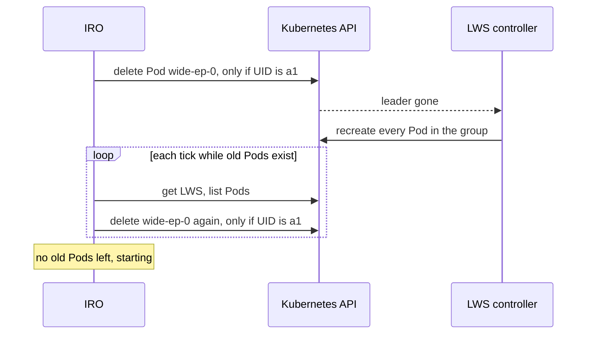

# LeaderWorkerSet Workload

The LWS client (`internal/workload/lws`) implements the
[workload contract](../design/adapters.md) for one LeaderWorkerSet group.

## Requirements

| Setting | Value |
| --- | --- |
| `spec.replicas` | `1` (one group) |
| `spec.leaderWorkerTemplate.size` | 1 or more; the number of Pods in the group |
| `spec.leaderWorkerTemplate.restartPolicy` | `RecreateGroupOnPodRestart` |
| `spec.groupIdentity` | unset or `Ordinal` |
| Pod names | `<lws>-0` for the leader, `<lws>-0-<i>` for workers |
| Ranks per Pod | the same in every Pod; rank = worker index × ranks per Pod + local index |

---

## Discover

Example for `wide-ep` with 2 Pods and 2 ranks each:

| Rank | URL | Pod |
| --- | --- | --- |
| 0 | `http://10.0.0.10:8000` | `wide-ep-0` |
| 1 | `http://10.0.0.10:8001` | `wide-ep-0` |
| 2 | `http://10.0.0.11:8000` | `wide-ep-0-1` |
| 3 | `http://10.0.0.11:8001` | `wide-ep-0-1` |

| | Built from | Changes when | Used for |
| --- | --- | --- | --- |
| Group ID | LWS UID, Pod UIDs, container IDs and restart counts | any Pod or container is replaced | spotting a new group, tagging rounds |
| Cache key | the same, plus Pod IPs and group size | also when an IP changes | skipping observer calls |

Reads go straight to the API server, not to a cache: one LWS get and one Pod
list per tick. Anything that doesn't match the requirements is an error, and
the controller treats it as "don't know".

---

## Reset

"Not found" and "UID doesn't match" both count as done, so repeating the
delete is safe.

---

## Journal

ConfigMap `<lws>-ft-state` in the LWS namespace. The first write creates it.
Later writes update it with the `resourceVersion` from the last read or write.
See [journal and failover](../design/journal-and-failover.md).

---

## RBAC

From [deploy/vllm-ft/access.yaml](../../deploy/vllm-ft/access.yaml), for the
`wide-ep` example:

| Resource | Verbs | Limited to | Used by |
| --- | --- | --- | --- |
| `leaderworkersets` | get | `wide-ep` | Discover |
| `pods` | get, list | the namespace | Discover |
| `pods` | delete | `wide-ep-0` | Reset |
| `configmaps` | get, update | `wide-ep-ft-state` | journal |
| `configmaps` | create | the namespace | first journal write |
| `leases` | get, list, watch, create, update, patch | the namespace | leader election |
| `events` | create, patch | the namespace | the manager |

---

## Limits

- One group: `replicas` must be 1.
- Two API reads per tick, plus a few more while verifying.
- If the LWS sets `maxGroupRestarts` or `restartBackoff`, those also limit how
  often IRO's resets take effect.
